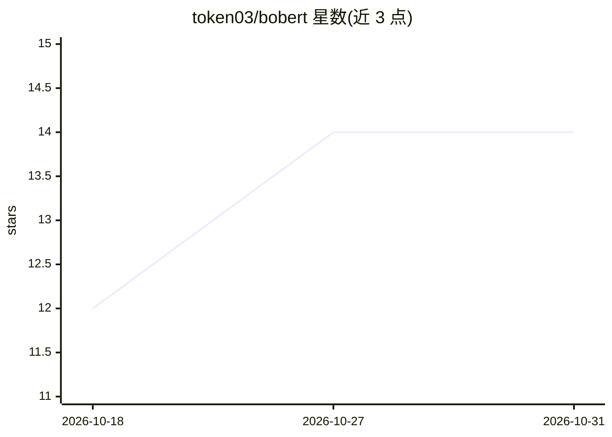

# token03/bobert

⭐ 14 · Python · MIT · 推送 2026-10-22 · [GitHub](https://github.com/token03/bobert) · [官网](https://bobert-web.pages.dev/) · 个人维护

**将 osu! 谱面编码为向量的 Transformer 模型，用于相似检索与推荐**

基于 ModernBERT 的双向 Transformer 编码器 BoBERT，读取 osu! 谱面的 hit objects（每个对象一个 token），输出 384 维谱面向量，覆盖 standard/taiko/catch/mania 四种规则集（各自独立编码器与权重）。预训练采用掩码重建与难度回归，再用收藏数据对比训练线性 adapter 做推荐与相似搜索。仓库含数据管线、训练代码、评估工具与 Web 应用（FastAPI + React），提供 Docker CPU 推理与本地训练流程。限制：不读取 AR/CS/OD/HP，仅读前 4,096 个对象，跨规则集不可比。

## 筛选速览

| 维度 | 判定 | 备注 |
|---|---|---|
| AI 角色 | `ai-native` | 本体是模型或模型工具 |
| 许可风险 | `permissive` | MIT |
| 部署形态 | `self-host` | docker 或自建部署 |
| 模型依赖 | — | README 未给出锁定关系 |
| 硬件要求 | `cpu-ok` | |
| 安装摩擦 | `low` | 无编译、无系统依赖或容器化 |
| 成熟度 | — | 结构信号不足 |

## 能力要点

- 四种规则集各一个 16.1M 参数编码器，输出 384 维谱面向量
- 掩码重建 + strain 回归预训练，收藏对对比训练 adapter
- API 可在 CPU 上以 Docker 运行，附 Web 搜索前端
- 提供 uv 管理的完整训练/嵌入/评估命令链

## 适用场景

- 按相似度搜索与推荐 osu! 谱面
- 基于收藏数据做谱面推荐
- 对谱面嵌入做检索分析与评测

## 场景标签

`语义搜索` `推荐系统` · 领域:知识与检索

## 证据(README 行号)

> L4: BoBERT encodes osu! beatmaps as fixed-size vectors. It supports osu!standard, taiko, catch and mania, with one encod
> L12: BoBERT is a bidirectional Transformer encoder based on ModernBERT. Each hit object is one token. A tokenizer in the

## 星数曲线

2026-10-18 12 → 2026-10-31 14（+2）

---
*卡片 v1 · prompt 1.4 · 生成 2026-10-31 · 置信度 high · 依据 README sha `25274412b854` · [字段定义](../../DATASET.md)*
