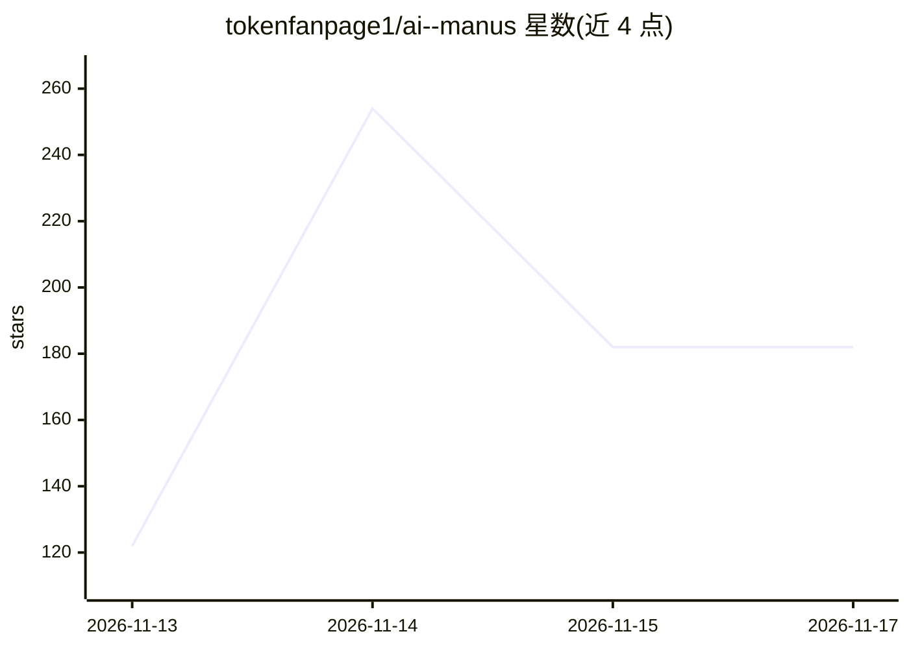

# tokenfanpage1/ai--manus

⭐ 182 · Apache-2.0 · 推送 2026-11-14 · [GitHub](https://github.com/tokenfanpage1/ai--manus) · 个人维护

**面向个人用户的自主 AI Agent：代为执行代码与浏览器操作**

定位为自主执行任务的 AI Agent：接受自然语言指令后代写并运行脚本、控制浏览器（导航页面、填表、采集信息）、执行多步骤任务，可在后台持续待命并跨会话复用任务模式。面向学生、远程工作者与轻量办公人群的家庭、学习与小项目场景，明确声明不是企业级平台。README 仅含功能宣传与配置建议，未提供安装命令、代码或技术实现细节（描述称支持沙箱运行工具，正文未展开）；附硬件兼容表（最低 4GB 内存、双核 CPU）。

## 筛选速览

| 维度 | 判定 | 备注 |
|---|---|---|
| AI 角色 | `ai-native` | 本体是模型或模型工具 |
| 许可风险 | `permissive` | Apache-2.0 |
| 部署形态 | `None` |  |
| 模型依赖 | — | README 未给出锁定关系 |
| 硬件要求 | — | 无带数字的原话,不猜 |
| 安装摩擦 | `low` | 无编译、无系统依赖或容器化 |
| 成熟度 | — | 结构信号不足 |

## 能力要点

- 自主编写并执行脚本完成任务
- 浏览器控制：导航、填表、信息采集
- 多步骤任务与跨会话任务模式复用
- 声明面向家庭/学习/轻办公的小规模场景

## 适用场景

- 让代理解替我完成重复的网页查证与表单填写
- 整理研究笔记、运行小型脚本
- 远程办公时从多个页面收集数据并汇总

## 场景标签

`编码 Agent` `浏览器自动化` `AI 助手` · 领域:效率与自动化

## 证据(README 行号)

> L10: - **Autonomous Code Execution:** Manus AI agent runs code on its own to complete tasks, so you can focus on decisio
> L18: Manus is an autonomous AI agent designed to run code and control a browser on your behalf. Instead of acting like a

## 星数曲线

2026-11-13 122 → 2026-11-17 182（+60）

---
*卡片 v1 · prompt 1.4 · 生成 2026-11-17 · 置信度 low · 依据 README sha `8234998f947a` · [字段定义](../../DATASET.md)*
