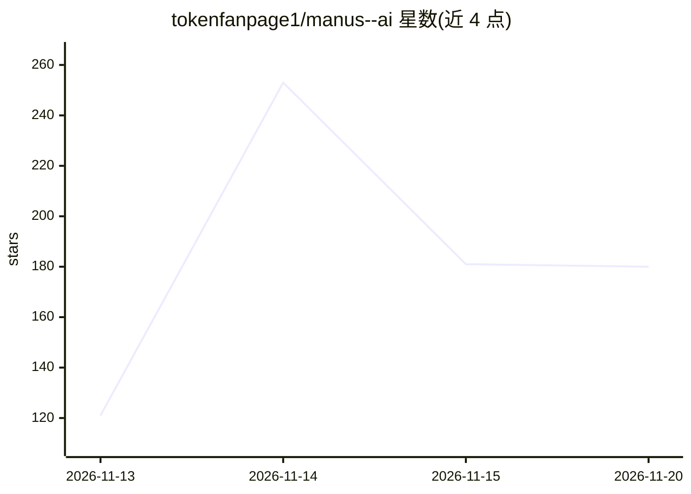

# tokenfanpage1/manus--ai

⭐ 180 · Apache-2.0 · 推送 2026-11-14 · [GitHub](https://github.com/tokenfanpage1/manus--ai) · 个人维护

**自主 AI Agent：代用户执行代码与控制浏览器完成任务**

面向个人用户（学生、远程工作者、家庭场景）的自主 AI Agent，README 描述其可自主编写并执行脚本、控制浏览器（导航网页、填写表单、收集信息），并以后台个人助手形式处理多步骤、重复性小任务。定位为非企业级平台，服务于学习、家庭与轻量办公场景。README 提供兼容性表（建议 8GB 内存）与上手步骤说明，但未给出具体安装命令、技术架构或模型接入方式。

## 筛选速览

| 维度 | 判定 | 备注 |
|---|---|---|
| AI 角色 | `ai-native` | 本体是模型或模型工具 |
| 许可风险 | `permissive` | Apache-2.0 |
| 部署形态 | `None` |  |
| 模型依赖 | — | README 未给出锁定关系 |
| 硬件要求 | — | 无带数字的原话,不猜 |
| 安装摩擦 | `low` | 无编译、无系统依赖或容器化 |
| 成熟度 | — | 结构信号不足 |

## 能力要点

- 自主代码执行：Agent 自行编写并运行脚本完成任务
- 浏览器控制：导航网站、填写表单、收集信息
- 代码与浏览器在同一工作流中衔接
- 跨会话保持一致的任务处理逻辑

## 适用场景

- 让学生组织研究资料、运行小脚本
- 让远程工作者从多个网页收集数据并汇总
- 把重复性的小任务交给后台助手处理

## 场景标签

`AI 助手` `编码 Agent` `浏览器自动化` · 领域:效率与自动化

## 证据(README 行号)

> L18: Manus is an autonomous AI agent designed to run code and control a browser on your behalf. Instead of acting like a
> L22: Manus is not a heavy studio suite or a complex enterprise platform. It is a focused helper built for home, study, a

## 星数曲线

2026-11-13 121 → 2026-11-20 180（+59）

---
*卡片 v1 · prompt 1.4 · 生成 2026-11-17 · 置信度 low · 依据 README sha `8234998f947a` · [字段定义](../../DATASET.md)*
