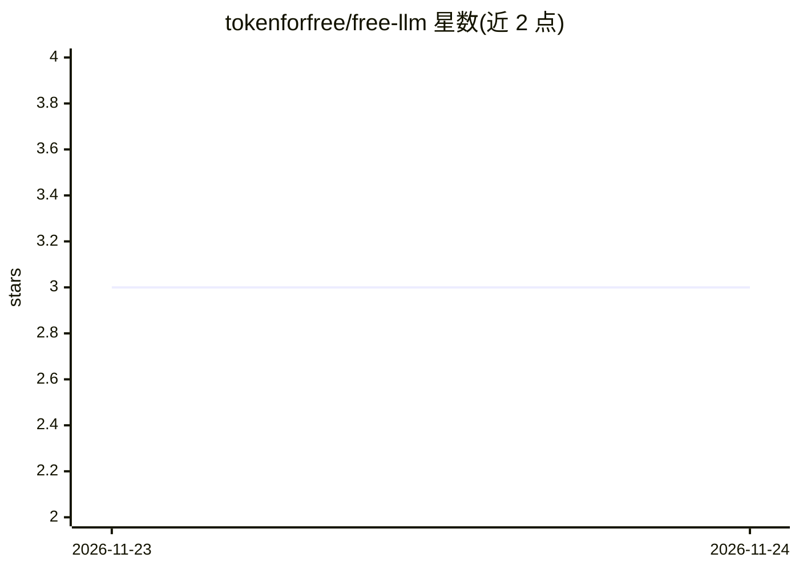

# tokenforfree/free-llm

⭐ 3 · HTML · MIT · 推送 2026-11-02 · [GitHub](https://github.com/tokenforfree/free-llm) · [官网](https://tokenforfree.github.io/free-llm/) · 个人维护 · 中文 README

**面向开发者的免费 LLM API/额度站点实测合集清单**

一个整理类资源清单：汇总 6 家提供免费额度或签到续期的第三方 LLM 中转/公益站，逐家列出注册方式、支持模型、兼容客户端与 API 端点，并给出 Claude Code 环境变量配置、OpenAI 兼容接入示例与多线路切换脚本；另附国内/海外厂商官方免费额度汇总表与 FAQ。内容为信息整理与接入指引，不含代码实现；README 口吻含大量宣传性表述，站点可用性依赖外部平台。

## 筛选速览

| 维度 | 判定 | 备注 |
|---|---|---|
| AI 角色 | `ai-knowledge` | 知识聚合/清单类 |
| 许可风险 | `permissive` | MIT |
| 部署形态 | `None` |  |
| 模型依赖 | — | README 未给出锁定关系 |
| 硬件要求 | — | 无带数字的原话,不猜 |
| 安装摩擦 | `low` | 无编译、无系统依赖或容器化 |
| 成熟度 | — | 结构信号不足 |

## 能力要点

- 汇总 6 家免费额度/签到续费站点，附注册方式与模型清单
- 各站点提供 Anthropic 原生与 OpenAI 兼容两套 base_url
- 给出 Claude Code 环境变量配置与多线路切换 shell 函数
- 附国内/海外厂商官方免费额度汇总表

## 适用场景

- 为零成本接入 LLM API 寻找有免费额度的中转站点
- 给 Claude Code/Cursor 等客户端配置备用 API 线路
- 查阅各厂商官方免费试用额度的政策对比

## 场景标签

`模型网关` `精选清单` · 领域:Agent 开发

## 证据(README 行号)

> L1: # ⚡ free-llm · 免费API · 免费Token · 2026 最新AI大模型免费公益站合集与实测指南
> L238: 本项目旨在整理高可用大模型免费 API、免费 Token 资源与公益站指引。内容持续高频实测更新，欢迎 Star 关注！

## 星数曲线

2026-11-23 3 → 2026-11-24 3（+0）

---
*卡片 v1 · prompt 1.4 · 生成 2026-11-23 · 置信度 high · 依据 README sha `b83acf0e9477` · [字段定义](../../DATASET.md)*
