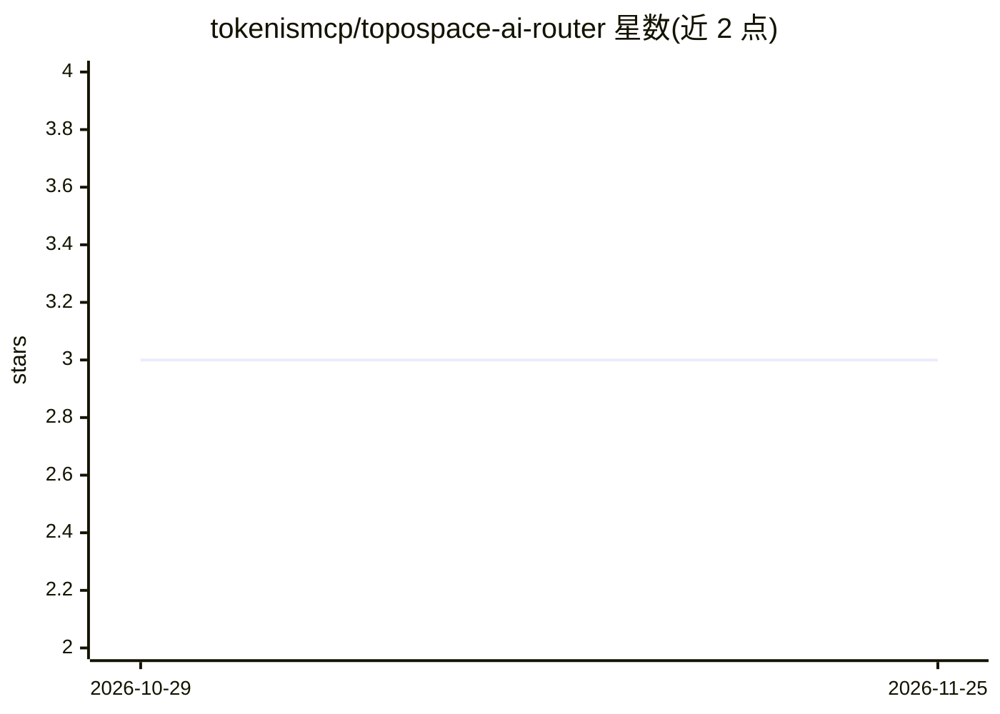

# tokenismcp/topospace-ai-router

⭐ 3 · 推送 2026-10-12 · [GitHub](https://github.com/tokenismcp/topospace-ai-router) · 个人维护

**为自有本地与托管模型做路由决策的 LLM 网关**

在用户自有机器或服务器上运行的 AI 路由程序：对每次请求统一决策暴露哪些上下文、调用哪个模型、走哪条执行路径、花费多少 token 预算。模型清单（提供商、价格、回退链、角色）由本地文件声明，密钥来自环境变量；提供商失败时沿回退链切换；支持 dry-run 解释决策并精确回放；以整数微美元记录哈希链式用量账本，并提供 Web 控制台展示决策拓扑。以编译后二进制分发，源码未公开，专有许可。

## 筛选速览

| 维度 | 判定 | 备注 |
|---|---|---|
| AI 角色 | `ai-ecosystem` | LLM/agent 周边工具 |
| 许可风险 | `none` | — |
| 部署形态 | `None` |  |
| 模型依赖 | — | README 未给出锁定关系 |
| 硬件要求 | — | 无带数字的原话,不猜 |
| 安装摩擦 | `low` | 无编译、无系统依赖或容器化 |
| 成熟度 | — | 结构信号不足 |

## 能力要点

- 上下文、模型、执行路径、token 预算四者作为一次联合决策
- 跨提供商回退链与哈希链式用量账本
- dry-run 可在不调用提供商的情况下解释决策并精确回放
- 兼容任意 OpenAI 客户端（base URL 指向本地端点）

## 适用场景

- 用自有 API key 在本地与托管模型之间做统一路由
- 为不同任务类型定义角色模型池并按成本-质量权衡调度
- 在本地运行超出内存的大模型（专家权重从磁盘流式读取）

## 场景标签

`模型网关` `推理引擎` · 领域:Agent 开发

## 证据(README 行号)

> L3: **An AI router that decides, as one joint decision, which context is exposed, which model
> L4: runs, which execution path is taken, and how many tokens are spent**, across your own
> L9: It runs on your machine or your servers; it is not a hosted marketplace of models, and
> L57: Any OpenAI client works against it: set its base URL to `http://localhost:8000/v1`.

## 星数曲线

2026-10-29 3 → 2026-11-25 3（+0）

---
*卡片 v1 · prompt 1.4 · 生成 2026-11-21 · 置信度 high · 依据 README sha `82715eef0e22` · [字段定义](../../DATASET.md)*
