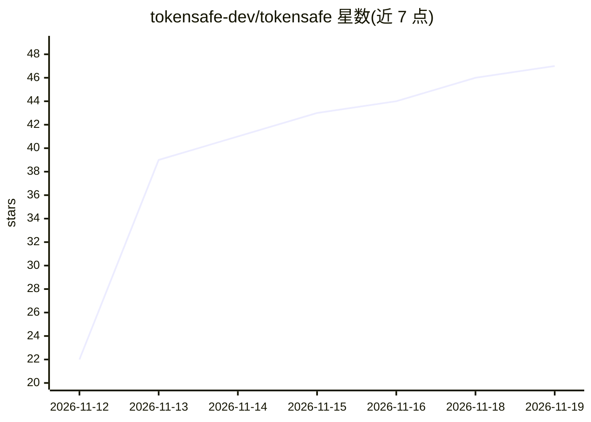

# tokensafe-dev/tokensafe

⭐ 47 · Python · MIT · 推送 2026-11-18 · [GitHub](https://github.com/tokensafe-dev/tokensafe) · [官网](https://tokensafe.dev) · 组织维护

**面向 AI 编程代理的本地上下文防火墙与零丢失运行时**

以 MCP 服务器 + CLI 形式接入 Cursor、Claude Code、Codex、Windsurf、Kimi Code 等 AI 编程代理，在代理与代码库之间做上下文治理：Tree-sitter AST 切片只保留目标符号与一跳依赖、lockfile/schema 截断为摘要、终端输出净化、循环防护与上下文压缩；另提供本地安全守卫拦截密钥写入与危险命令，SQLite FTS5 代码搜索与团队共享缓存。四个公开工具免 key 使用，云端功能（团队指标、共享缓存、计费）需许可证 key，定价 $29/席位。

## 筛选速览

| 维度 | 判定 | 备注 |
|---|---|---|
| AI 角色 | `ai-ecosystem` | LLM/agent 周边工具 |
| 许可风险 | `permissive` | MIT |
| 部署形态 | `library` | 以包/库形式分发 |
| 模型依赖 | — | README 未给出锁定关系 |
| 硬件要求 | — | 无带数字的原话,不猜 |
| 安装摩擦 | `low` | 无编译、无系统依赖或容器化 |
| 成熟度 | — | 结构信号不足 |

## 能力要点

- Tree-sitter AST 切片支持 11 种语言，声称保留目标符号并折叠无关代码
- 一条 npx 命令自动检测并接入 11 种 AI 编程代理（MCP + hooks）
- 本地 TokenSafe Guard 在写入/执行前拦截密钥、TLS 绕过与危险命令
- SQLite FTS5 BM25 代码搜索、Graph 缓存、团队共享缓存与失败记录台账

## 适用场景

- 编码代理在大型仓库中读整文件导致上下文爆满、配额提前耗尽
- 防止自主代理把 .env 密钥提交进 git 或硬编码回退凭据
- 团队内共享缓存与按席位查看 AI 使用 ROI

## 场景标签

`网络安全` · 领域:学习与行业

## 证据(README 行号)

> L7:  TokenSafe strips the noise with Tree-sitter AST slicing so your agent stays razor-sharp, changes only the lines you
> L53: The installer detects which agents live on your machine, registers the TokenSafe MCP server, injects project rules,
> L79: Cloud features (team metrics, managed distillation, shared team cache, billing) run on the remote endpoint `https:/

## 星数曲线

2026-11-12 22 → 2026-11-19 47（+25）

---
*卡片 v1 · prompt 1.4 · 生成 2026-11-18 · 置信度 mid · 依据 README sha `cbea29c3cd99` · [字段定义](../../DATASET.md)*
