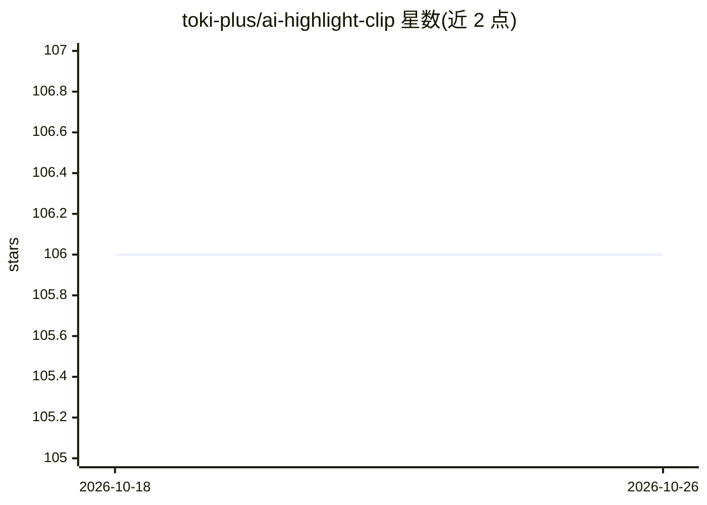

# toki-plus/ai-highlight-clip

⭐ 106 · Python · MIT · 推送 2026-08-08 · [GitHub](https://github.com/toki-plus/ai-highlight-clip) · 组织维护 · 中文 README

**AI 辅助长视频高光剪辑工具：转写评分定位候选片段**

面向课程、访谈、播客和直播团队的桌面端（PyQt5）剪辑工作流：用 Whisper 将长视频转写为带时间戳文本，经滑动窗口遍历全文，由大语言模型（DashScope）结合用户提示词与关键词为候选片段打分，按评分、关键词密度与重叠度三维排序筛选 TOP N，生成标题草稿与字幕，FFmpeg 裁剪输出候选片段。定位为初筛辅助，最终选片与标题由人工终审；输出质量受录音质量与提示词影响，长视频需较多计算资源。

## 筛选速览

| 维度 | 判定 | 备注 |
|---|---|---|
| AI 角色 | `ai-native` | 本体是模型或模型工具 |
| 许可风险 | `permissive` | MIT |
| 部署形态 | `library` | 以包/库形式分发 |
| 模型依赖 | — | README 未给出锁定关系 |
| 硬件要求 | — | 无带数字的原话,不猜 |
| 安装摩擦 | `medium` | 含编译或系统依赖之一 |
| 成熟度 | `idea` | |

## 能力要点

- Whisper 多语言转写与时间轴对齐
- 滑动窗口扫描 + LLM 高光指数评分 + 三维排序筛选 TOP N
- 标题草稿生成（人工终审）与字幕断句排版优化
- 支持整目录批量处理，PyQt5 桌面界面展示进度与日志

## 适用场景

- 把数小时课程或直播回放初筛为候选高光短视频
- 批量处理整套课程/剧集素材，按指定主题筛片段
- 获得带时间戳字幕与标题草稿的候选片段后人工终审发布

## 场景标签

`语音识别` `图像视频处理` · 领域:感知与多模态

## 证据(README 行号)

> L23: - **语音识别与时间轴对齐**：集成 OpenAI Whisper 模型，将视频语音精准转写为带时间戳的字幕文本，支持多语言识别，可按精度与硬件条件选择不同规模的模型
> L25: - **LLM 内容评分**：利用大语言模型理解转录文本的上下文，结合用户提示词与自定义关键词，为每个候选片段给出"高光指数"评分
> L5: 将长视频转化为候选高光片段的 AI 辅助剪辑工作流。

## 星数曲线

2026-10-18 106 → 2026-10-26 106（+0）

---
*卡片 v1 · prompt 1.4 · 生成 2026-10-23 · 置信度 mid · 依据 README sha `2c50b858ab45` · [字段定义](../../DATASET.md)*
