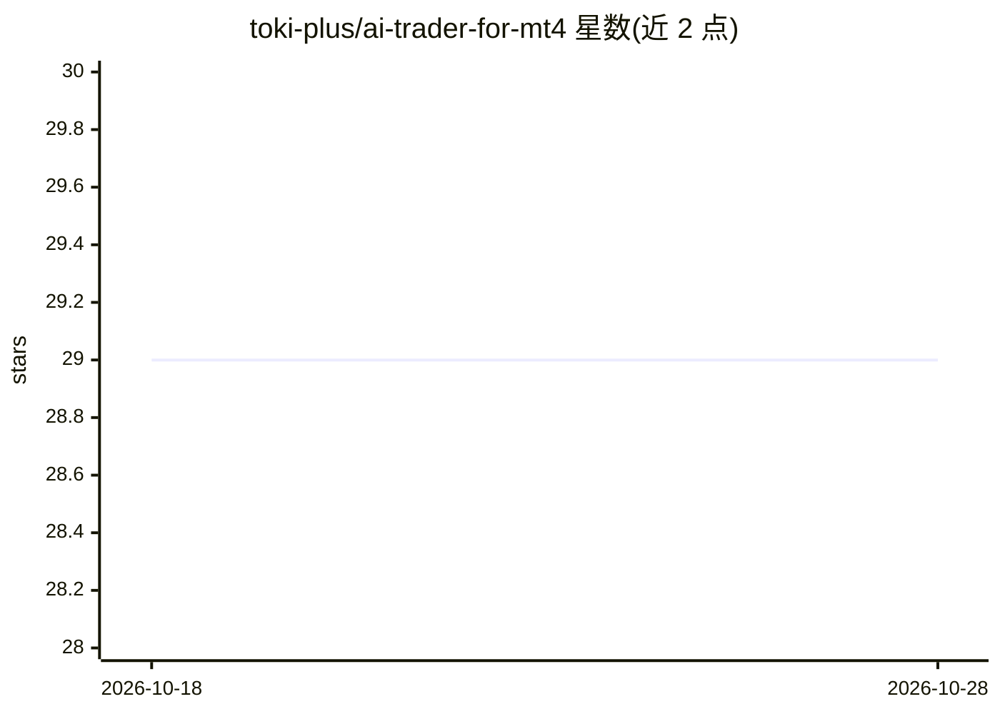

# toki-plus/ai-trader-for-mt4

⭐ 29 · Python · MIT · 推送 2026-08-08 · [GitHub](https://github.com/toki-plus/ai-trader-for-mt4) · 个人维护 · 中文 README

**将 LLM 接入 MetaTrader 4 的 AI 交易研究与执行框架**

Python 桌面应用（PyQt5 GUI），通过 MQL4/Files 目录的 .txt 文件桥接与 MT4 EA 异步通信，让大模型按 Prepare-Scan-Act-Conclude 的 ReAct 式流程调用 30 余个结构化交易工具（扫描、止损计算、开平仓等），并以确定性规则校验仓位、止损与重复操作。支持 OpenAI / DeepSeek / Moonshot 模型切换，SQLite 记录订单与决策日志。提供 Releases 免安装包与源码运行两种方式，需 Windows + MT4 终端 + LLM API Key；文件桥接存在轮询延迟，明确声明仅供研究、建议仅用模拟账户。

## 筛选速览

| 维度 | 判定 | 备注 |
|---|---|---|
| AI 角色 | `ai-ecosystem` | LLM/agent 周边工具 |
| 许可风险 | `permissive` | MIT |
| 部署形态 | `desktop` | 安装包/桌面程序 |
| 模型依赖 | locked-api |  |
| 硬件要求 | — | 无带数字的原话,不猜 |
| 安装摩擦 | `low` | 无编译、无系统依赖或容器化 |
| 成熟度 | — | 结构信号不足 |

## 能力要点

- 文件级 MT4-Python 异步桥接（生产者-消费者模式，免 DLL）
- Prepare->Scan->Act->Conclude 流程循环与 30 余个原子工具、四大工作流工具
- 确定性风险规则校验与 A/B/C 信号分级、分批止盈利润阶梯
- SQLite 订单镜像与 AI 元数据继承（部分平仓后管理逻辑连续）

## 适用场景

- 在 MT4 上构建工具驱动、风险边界受控的 AI 交易机器人
- 逐条复盘 AI 的思考、工具调用与观察日志做量化研究
- 在模拟账户上验证 LLM 驱动的交易决策流程

## 场景标签

`金融量化` `AI 助手` · 领域:对话与助手

## 证据(README 行号)

> L7: 项目将市场数据工具、策略配置、风险规则、信号生命周期、MT4 通信和大模型分析整合为可追踪的桌面应用。设计重点是让模型在明确工具和风险边界内工作，而不是将交易权限无约束地交给 AI。
> L41: - `src/bridge/`：MT4 通信与 AI 客户端边界

## 星数曲线

2026-10-18 29 → 2026-10-28 29（+0）

---
*卡片 v1 · prompt 1.4 · 生成 2026-10-26 · 置信度 mid · 依据 README sha `f0788d0e22b8` · [字段定义](../../DATASET.md)*
