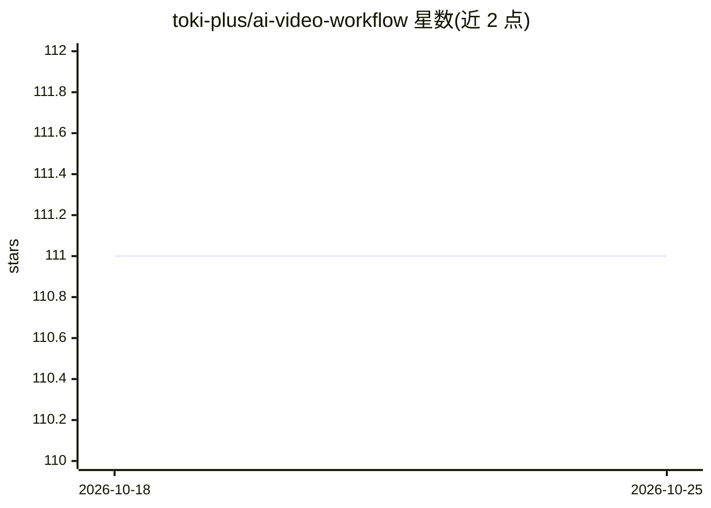

# toki-plus/ai-video-workflow

⭐ 111 · Python · MIT · 推送 2026-08-08 · [GitHub](https://github.com/toki-plus/ai-video-workflow) · 组织维护 · 中文 README

**多模型协同的 AIGC 短视频生成桌面工作流原型**

PyQt5 桌面应用，将豆包提示词生成、LibLibAI 文生图、火山引擎即梦图生视频与文生音乐、FFmpeg 合成串联为三阶段可视化流水线。核心机制包括跨服务异步任务编排（轮询/超时/失败恢复）、候选图片翻页对比、提示词确认/选片/终审等人工选择点，每个供应商封装为可替换客户端。需自备三家服务的 API 凭据，定位为原型验证，无自动化测试与 CI。

## 筛选速览

| 维度 | 判定 | 备注 |
|---|---|---|
| AI 角色 | `ai-native` | 本体是模型或模型工具 |
| 许可风险 | `permissive` | MIT |
| 部署形态 | `library` | 以包/库形式分发 |
| 模型依赖 | — | README 未给出锁定关系 |
| 硬件要求 | — | 无带数字的原话,不猜 |
| 安装摩擦 | `medium` | 含编译或系统依赖之一 |
| 成熟度 | `idea` | |

## 能力要点

- 串联豆包提示词生成、LibLibAI 文生图、即梦图生视频与文生音乐
- 跨服务异步任务编排：轮询状态、超时与失败恢复
- 提示词确认、选片、最终审核等关键节点保留人工选择
- 每个供应商封装为可替换客户端，提示词策略可扩展注册

## 适用场景

- 一键生成带配乐的 AIGC 短视频并人工选片定稿
- 探索多个 AI 生成服务的任务编排与状态管理
- 为短视频批量产出图片、音乐提示词及标题标签草稿

## 场景标签

`图像生成` `视频生成` · 领域:内容生成

## 证据(README 行号)

> L5: 用于验证多模型协同的视频生成工作流原型。
> L7: 项目将提示词生成、文生图、图生视频、文生音乐和媒体合成串联在一个桌面应用中，重点探索不同 AI 服务之间的任务编排、状态管理与人工选择点。
> L17: - **AI 提示词生成**：内置基于豆包（Doubao）大模型的提示词生成器，提供多种预设主题与场景组合，一键产出整套图片、音乐提示词以及标题与标签草稿（发布前需人工确认）

## 星数曲线

2026-10-18 111 → 2026-10-25 111（+0）

---
*卡片 v1 · prompt 1.4 · 生成 2026-10-23 · 置信度 mid · 依据 README sha `cecd815835d8` · [字段定义](../../DATASET.md)*
