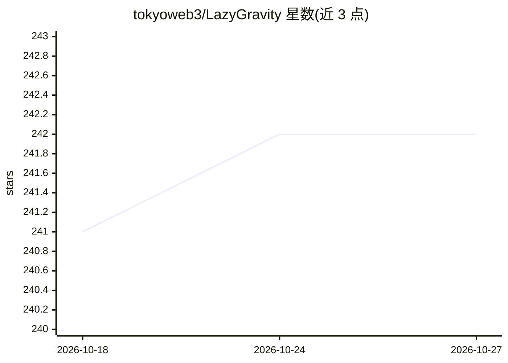

# tokyoweb3/LazyGravity

⭐ 242 · TypeScript · MIT · 推送 2026-09-06 · [GitHub](https://github.com/tokyoweb3/LazyGravity) · 个人维护

**通过 Discord/Telegram 远程操控本机 Antigravity IDE 的本地机器人**

本地运行的 Node.js 机器人，把 Discord（默认）与 Telegram（可选，需 grammy）的消息转发给家里电脑上的 Antigravity IDE，通过 Chrome DevTools Protocol（WebSocket、Runtime.evaluate）注入指令、监听回复并截图回传。支持频道-目录项目绑定、多会话、LLM 模型与模式切换（如 gpt-4o、claude-3-opus）、定时任务（cron）、模板与自动接受编辑等斜杠命令。限定白名单用户访问，凭据存本地；要求 Node >= 22.14 与已安装 Antigravity IDE。

## 筛选速览

| 维度 | 判定 | 备注 |
|---|---|---|
| AI 角色 | `ai-ecosystem` | LLM/agent 周边工具 |
| 许可风险 | `permissive` | MIT |
| 部署形态 | `desktop` | 安装包/桌面程序 |
| 模型依赖 | — | README 未给出锁定关系 |
| 硬件要求 | — | 无带数字的原话,不猜 |
| 安装摩擦 | `low` | 无编译、无系统依赖或容器化 |
| 成熟度 | — | 结构信号不足 |

## 能力要点

- Discord/Telegram 双平台远程下发自然语言任务并回传结果与截图
- 通过 CDP（端口 9222 等自动扫描）连接并注入 Antigravity 会话
- 项目/频道绑定、多会话、模板、cron 定时任务等 20+ 斜杠命令
- 白名单访问控制、本地凭据存储、断线自动重连（最多 3 次）

## 适用场景

- 出门在外用手机 Discord 继续驱动家里电脑上的 Antigravity 做编码任务
- 把聊天频道绑定到本地项目目录，异地管理多个代码项目
- 设置 cron 定时任务让 Antigravity 周期性执行固定指令

## 场景标签

`编码 Agent` · 领域:编码与开发

## 证据(README 行号)

> L13: **LazyGravity** is a local, secure bot that lets you remotely operate Antigravity on your home PC — from your smart
> L209: LazyGravity connects to Antigravity via Chrome DevTools Protocol (CDP).

## 星数曲线

2026-10-18 241 → 2026-10-27 242（+1）

---
*卡片 v1 · prompt 1.4 · 生成 2026-10-22 · 置信度 high · 依据 README sha `39d6268429cc` · [字段定义](../../DATASET.md)*
