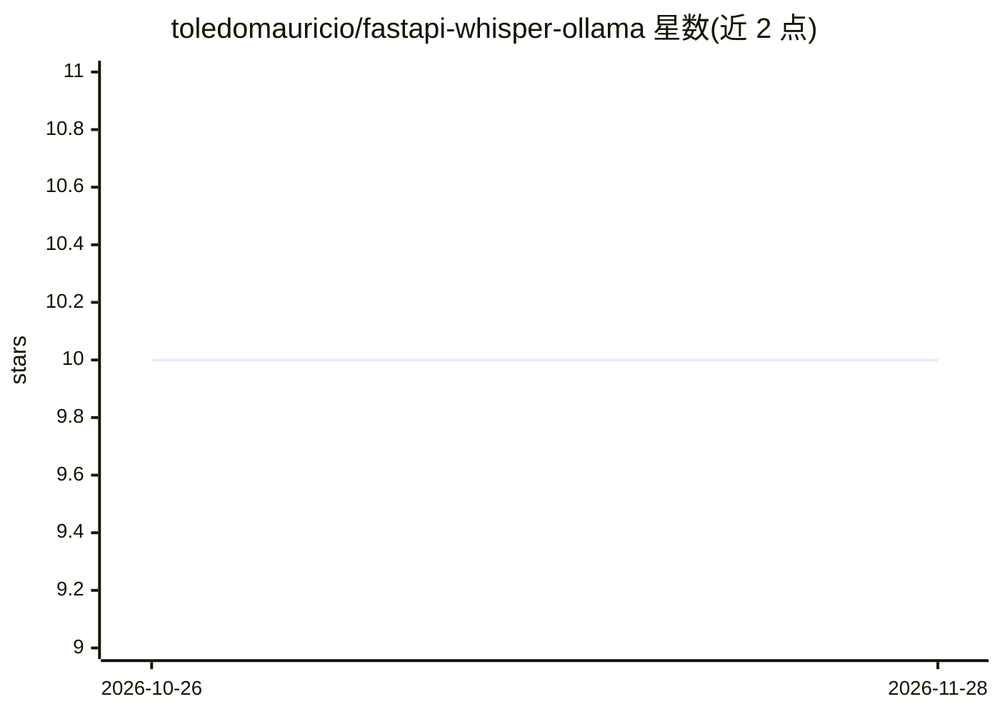

# toledomauricio/fastapi-whisper-ollama

⭐ 10 · Python · 推送 2026-01-21 · [GitHub](https://github.com/toledomauricio/fastapi-whisper-ollama) · 个人维护

**音频转写并经 Ollama LLM 处理的 FastAPI 服务**

一个后端 API 服务，将 OpenAI Whisper 的语音转文字与 Ollama 大模型处理串联：用户提交音频，服务先转写为文本，再交由 Ollama 模型做后续 LLM 处理。基于 FastAPI 构建，以 Web API 形式对外提供转写与处理能力，面向需要自建语音转写加 LLM 处理接口的开发者。README 仅一行描述，安装步骤与运行细节未在可见内容中给出。

## 筛选速览

| 维度 | 判定 | 备注 |
|---|---|---|
| AI 角色 | `ai-native` | 本体是模型或模型工具 |
| 许可风险 | `none` | — |
| 部署形态 | `None` |  |
| 模型依赖 | local-ok | 支持本地模型 |
| 硬件要求 | — | 无带数字的原话,不猜 |
| 安装摩擦 | `low` | 无编译、无系统依赖或容器化 |
| 成熟度 | — | 结构信号不足 |

## 能力要点

- 提供音频语音转文字（Whisper）的 API 服务
- 转写结果交由 Ollama 本地 LLM 模型处理
- 基于 FastAPI 框架构建后端接口

## 适用场景

- 把录音/语音消息批量转成文字
- 转写后用本地 LLM 做摘要或加工
- 为应用自托管语音输入的文本处理接口

## 场景标签

`语音识别` · 领域:感知与多模态

## 证据(README 行号)

> L2: FastAPI + Whisper + Ollama: Audio transcription and LLM processing API. Convert speech to text with OpenAI Whisper a

## 星数曲线

2026-10-26 10 → 2026-11-28 10（+0）

---
*卡片 v1 · prompt 1.4 · 生成 2026-11-19 · 置信度 mid · 依据 README sha `1b4ec2f457bc` · [字段定义](../../DATASET.md)*
