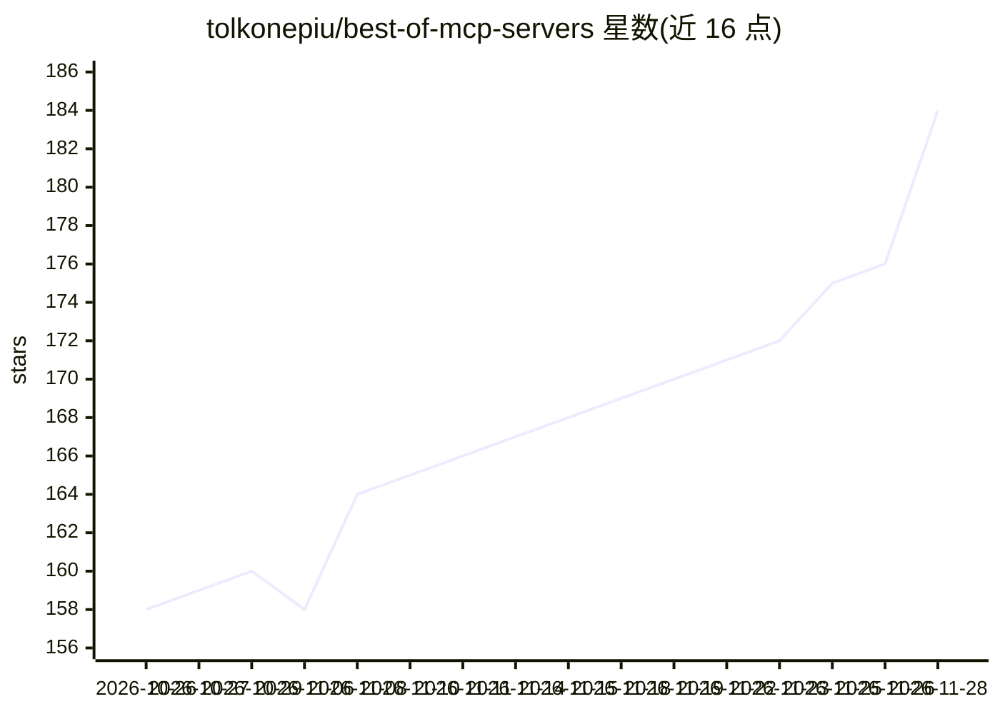

# tolkonepiu/best-of-mcp-servers

⭐ 184 · CC-BY-SA-4.0 · 推送 2026-11-27 · [GitHub](https://github.com/tolkonepiu/best-of-mcp-servers) · 个人维护

**每周更新的 MCP 服务器排名清单（480 项，38 类）**

基于 best-of 模板自动生成的 MCP（Model Context Protocol）服务器编目清单，收录 480 个项目并按 38 个类别组织。排名依据从 GitHub 与包管理器自动采集的指标计算的项目质量分，条目标注星数、贡献者、issue、下载量、许可证风险等符号，并区分新项目、不活跃与死亡项目。数据源为 projects.yaml，接受 issue、PR 或直接编辑的方式添加与更新项目，每周更新。

## 筛选速览

| 维度 | 判定 | 备注 |
|---|---|---|
| AI 角色 | `ai-knowledge` | 知识聚合/清单类 |
| 许可风险 | `viral` | CC-BY-SA-4.0 |
| 部署形态 | `None` |  |
| 模型依赖 | — | README 未给出锁定关系 |
| 硬件要求 | — | 无带数字的原话,不猜 |
| 安装摩擦 | `low` | 无编译、无系统依赖或容器化 |
| 成熟度 | — | 结构信号不足 |

## 能力要点

- 收录 480 个 MCP 服务器，合计 260 万星，分 38 个类别
- 基于 GitHub 与包管理器指标自动计算项目质量分并排名
- 用符号标注活跃度、趋势、许可证警告等元信息
- 数据源 projects.yaml 可通过 issue/PR/直接编辑贡献

## 适用场景

- 为 AI agent 或 IDE 选型 MCP 服务器时按类别浏览候选
- 按质量分与活跃度符号筛选可靠的 MCP 项目
- 将自己维护的 MCP 服务器提交收录进清单

## 场景标签

`精选清单` · 领域:学习与行业

## 证据(README 行号)

> L5:  🏆&nbsp; A ranked list of MCP servers. Updated weekly.
> L7: This curated list contains 480 awesome MCP (Model Context Protocol) servers with a total of 2.6M stars grouped into 

## 星数曲线

2026-10-26 158 → 2026-11-28 184（+26）

---
*卡片 v1 · prompt 1.4 · 生成 2026-11-26 · 置信度 high · 依据 README sha `98a0711ae526` · [字段定义](../../DATASET.md)*
