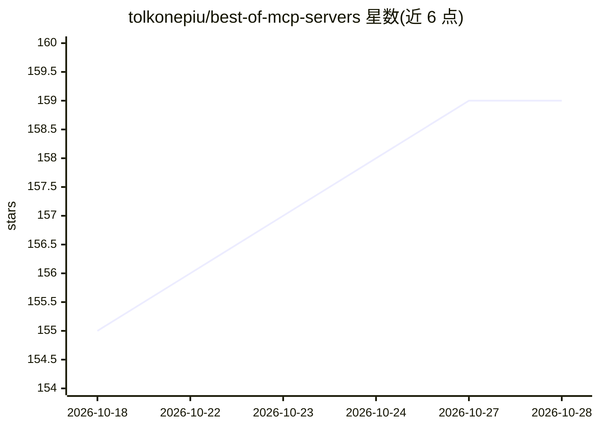

# tolkonepiu/best-of-mcp-servers

⭐ 159 · CC-BY-SA-4.0 · 推送 2026-10-27 · [GitHub](https://github.com/tolkonepiu/best-of-mcp-servers) · 个人维护

**MCP 服务器排行清单：400 个项目按 34 类自动评分排名**

由 best-of 框架自动生成并每周更新的 MCP（Model Context Protocol）服务器策展清单：收录 400 个项目、合计 1.4M stars，按聚合器、艺术文化、浏览器自动化、生物医学、云平台等 34 个类别组织。每个条目附带基于 GitHub 与各包管理器指标自动计算的项目质量评分，并展示 star 数、贡献者数、issue 数、下载量、活跃状态（新项目/不活跃/停止维护）与许可证风险标记。用户可通过 issue、PR 或编辑 projects.yaml 参与贡献。

## 筛选速览

| 维度 | 判定 | 备注 |
|---|---|---|
| AI 角色 | `ai-knowledge` | 知识聚合/清单类 |
| 许可风险 | `viral` | CC-BY-SA-4.0 |
| 部署形态 | `self-host` | docker 或自建部署 |
| 模型依赖 | — | README 未给出锁定关系 |
| 硬件要求 | — | 无带数字的原话,不猜 |
| 安装摩擦 | `low` | 无编译、无系统依赖或容器化 |
| 成熟度 | — | 结构信号不足 |

## 能力要点

- 收录 400 个 MCP 服务器项目，分为 34 个类别
- 条目按自动计算的项目质量评分排名，每周更新
- 展示 GitHub 指标（star/贡献者/fork/issue）与包管理器下载量
- 标记项目活跃状态（新/不活跃/停止维护）与许可证风险

## 适用场景

- 为 MCP 客户端挑选各领域的 MCP 服务器
- 按质量评分比较同类 MCP 项目的热度与活跃度
- 发现新出现的或避免已停止维护的 MCP 服务器

## 场景标签

`精选清单` · 领域:学习与行业

## 证据(README 行号)

> L5:  🏆&nbsp; A ranked list of MCP servers. Updated weekly.
> L7: This curated list contains 400 awesome MCP (Model Context Protocol) servers with a total of 1.4M stars grouped into 

## 星数曲线

2026-10-18 155 → 2026-10-28 159（+4）

---
*卡片 v1 · prompt 1.4 · 生成 2026-10-22 · 置信度 mid · 依据 README sha `f137fd6f3207` · [字段定义](../../DATASET.md)*
