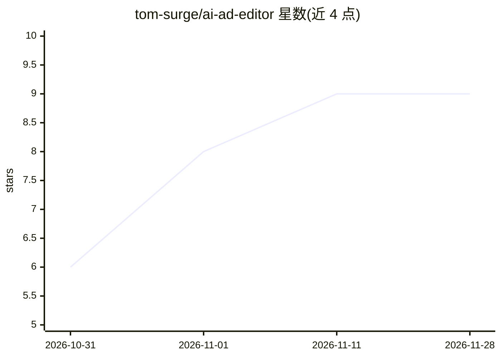

# tom-surge/ai-ad-editor

⭐ 9 · Python · MIT · 推送 2026-10-29 · [GitHub](https://github.com/tom-surge/ai-ad-editor) · 个人维护

**把广告脚本剪成成片视频广告的 Claude 技能，面向广告投放者**

一个安装在 Claude 中的技能（SKILL.md + Python 脚本）：用户粘贴广告脚本后，Claude 按流程规划分镜、生成角色与素材（或从自有素材库检索片段）、按逐词时间轴剪切并配字幕、音乐和尾卡，交付前逐项校验（口播逐词匹配、黑帧/冻结帧/规格）。面向制作短视频广告的广告主与团队。所有付费生成需逐步确认或设预算上限；素材库模式不产生生成费用；口播计时首次运行会下载一个小型语音模型。

## 筛选速览

| 维度 | 判定 | 备注 |
|---|---|---|
| AI 角色 | `ai-native` | 本体是模型或模型工具 |
| 许可风险 | `permissive` | MIT |
| 部署形态 | `library` | 以包/库形式分发 |
| 模型依赖 | locked-api |  |
| 硬件要求 | — | 无带数字的原话,不猜 |
| 安装摩擦 | `medium` | 含编译或系统依赖之一 |
| 成熟度 | — | 结构信号不足 |

## 能力要点

- 脚本→分镜→素材→成片的分步流程，每步在对话中确认
- AI 生成片段、自有素材库或混合三种剪辑来源
- 一次剪辑输出 9:16/4:5/1:1/16:9 多尺寸与多个 hook 变体
- 可接入其他 API 或 MCP 生成图像/视频/音频，无工具时输出手动运行提示词

## 适用场景

- 把广告脚本快速剪成 TikTok/竖版视频广告
- 用自有素材库低成本剪辑口播对齐的广告
- 为同一支广告生成多个 hook 版本做多尺寸投放

## 场景标签

`视频生成` · 领域:内容生成

## 证据(README 行号)

> L3: **A free Claude skill that turns your ad script into a finished video ad, from AI clips, your own clip library, or b
> L5: Paste a script. Claude plans every shot, makes the characters, images, clips and voiceover with the AI tools you alr
> L98: - Python 3.9+ with `faster-whisper`, `imageio-ffmpeg`, `pillow` and `numpy` (`imageio-ffmpeg` gives you ffmpeg if y

## 星数曲线

2026-10-31 6 → 2026-11-28 9（+3）

---
*卡片 v1 · prompt 1.4 · 生成 2026-11-20 · 置信度 high · 依据 README sha `173ad425df96` · [字段定义](../../DATASET.md)*
