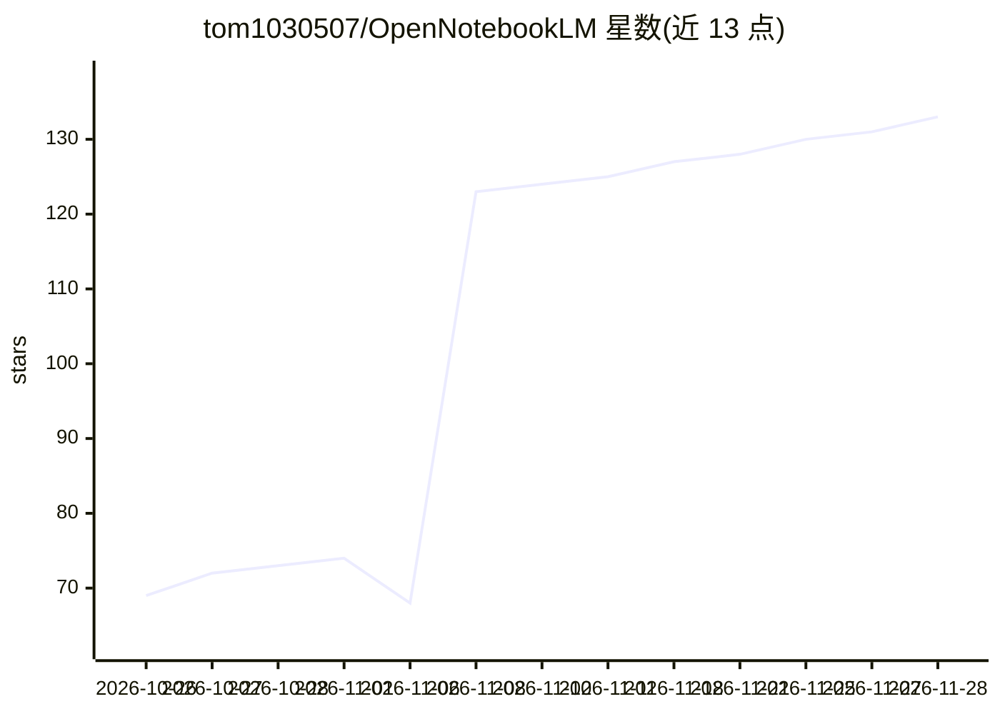

# tom1030507/OpenNotebookLM

⭐ 133 · Python · MIT · 推送 2026-11-25 · [GitHub](https://github.com/tom1030507/OpenNotebookLM) · 个人维护

**自托管的 NotebookLM 替代品：导入资料做带引用的问答**

自托管的研究工作区应用：导入 PDF、网页、YouTube、音频、Obsidian 仓库等来源，对所选来源提问并生成带回引内联引用的回答；采用稠密检索加 BM25 的混合检索，数据存于本地 SQLite。提供笔记、报告、思维导图、双主持人音频、旁白幻灯片、闪卡测验等 Studio 生成功能，支持项目共享与权限管理。后端 FastAPI、前端 Next.js，通过 Docker Compose 部署；可选 Claude、OpenAI 兼容 provider 或本地 Ollama，无 LLM 时提供抽取式回退回答。

## 筛选速览

| 维度 | 判定 | 备注 |
|---|---|---|
| AI 角色 | `ai-native` | 本体是模型或模型工具 |
| 许可风险 | `permissive` | MIT |
| 部署形态 | `self-host` | docker 或自建部署 |
| 模型依赖 | local-ok | 支持本地模型 |
| 硬件要求 | — | 无带数字的原话,不猜 |
| 安装摩擦 | `low` | 无编译、无系统依赖或容器化 |
| 成熟度 | — | 结构信号不足 |

## 能力要点

- 混合稠密 + BM25 检索，回答带内联引用并可溯源到原文段落
- 来源支持 PDF/docx/音视频/YouTube/Obsidian/Git 仓库等，OCR 与 Whisper 转录本地运行
- Studio 生成引用报告、思维导图、双主持人音频、旁白幻灯片、闪卡与测验
- 多模型选择：Claude、OpenAI 兼容 provider 或本地 Ollama，支持抽取式无模型回退

## 适用场景

- 把论文和资料导入后做带引用的问答与笔记整理
- 在本地私有化部署一个资料问答与研究工作区
- 从资料生成学习指南、思维导图、播客式音频和幻灯片
- 把文档转成闪卡和测验进行复习

## 场景标签

`文档问答` · 领域:知识与检索

## 证据(README 行号)

> L6:  A self-hosted alternative to Google NotebookLM for reading, asking questions,
> L23: Import a paper, a spreadsheet, a recording, or a set of links. Ask questions
> L55: |**Choose your model**|Use Claude, OpenAI, another OpenAI-compatible provider, or a local server such as Ollama. Se

## 星数曲线

2026-10-26 69 → 2026-11-28 133（+64）

---
*卡片 v1 · prompt 1.4 · 生成 2026-11-28 · 置信度 mid · 依据 README sha `8b0ebcf994d7` · [字段定义](../../DATASET.md)*
