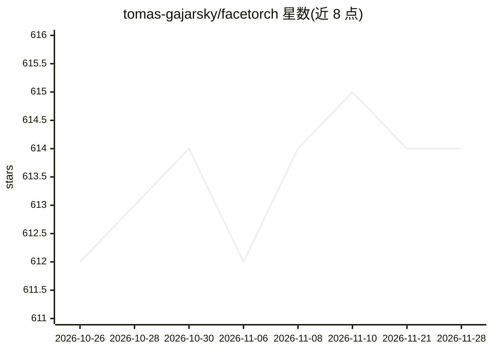

# tomas-gajarsky/facetorch

⭐ 614 · Python · Apache-2.0 · 推送 2026-11-26 · [GitHub](https://github.com/tomas-gajarsky/facetorch) · 个人维护

**基于 PyTorch 的人脸检测与分析 Python 库**

facetorch 是一个用于人脸检测与分析的 Python 库，将社区开源人脸分析模型打包为 torch.export（.pt2）可移植模型并集成到统一工具链中。通过 Hydra/OmegaConf 进行可定制配置，支持 Docker 容器化与 conda-lock 依赖锁定以保证环境可复现；输入支持本地路径、张量、NumPy 数组、PIL 图像与字节流。RC5 要求 Python 3.11/3.12，Linux x86-64 为官方支持平台，Windows/macOS/ARM 为实验性。提供 pip、Docker/Compose 与 Python API 三种使用方式。

## 筛选速览

| 维度 | 判定 | 备注 |
|---|---|---|
| AI 角色 | `ai-native` | 本体是模型或模型工具 |
| 许可风险 | `permissive` | Apache-2.0 |
| 部署形态 | `self-host` | docker 或自建部署 |
| 模型依赖 | — | README 未给出锁定关系 |
| 硬件要求 | — | 无带数字的原话,不猜 |
| 安装摩擦 | `low` | 无编译、无系统依赖或容器化 |
| 成熟度 | `idea` | |

## 能力要点

- 模型以 torch.export 序列化为 .pt2 格式，推理时无需模型源码
- Hydra/OmegaConf 可定制配置与 Docker 容器化运行
- 输入支持路径、张量、NumPy、PIL、bytes 的统一管道
- URLReader 提供带超时、重定向与大小上限的显式远程读取配置

## 适用场景

- 检测图像中人脸并生成边界框与 3D 关键点
- 批量运行人脸验证、表情识别等分析模型
- 用 Docker Compose 在 CPU/GPU 上运行人脸分析示例

## 场景标签

`人脸识别` · 领域:感知与多模态

## 证据(README 行号)

> L17: **Facetorch** is a Python library designed for facial detection and analysis, leveraging the power of deep neural n
> L34: Facetorch provides an efficient, scalable, and user-friendly solution for facial analysis tasks, catering to develo

## 星数曲线

2026-10-26 612 → 2026-11-28 614（+2）

---
*卡片 v1 · prompt 1.4 · 生成 2026-11-25 · 置信度 high · 依据 README sha `5bfc47ad1e56` · [字段定义](../../DATASET.md)*
