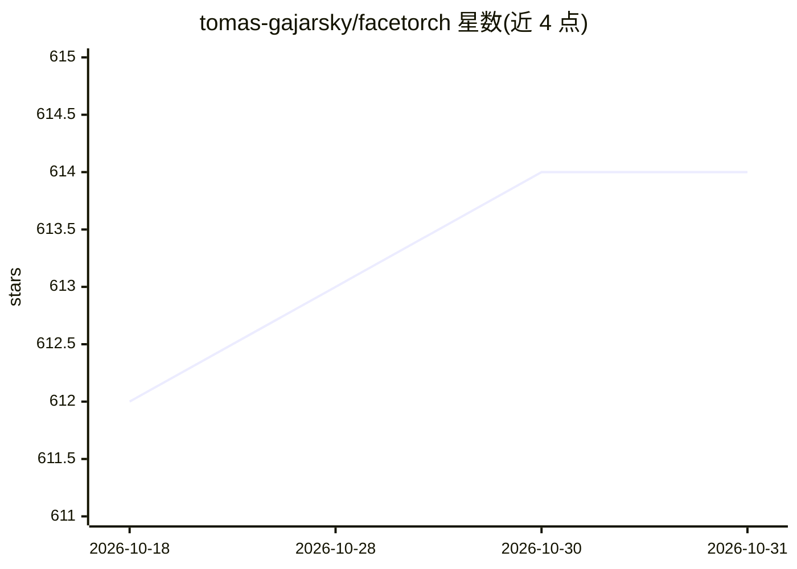

# tomas-gajarsky/facetorch

⭐ 614 · Python · Apache-2.0 · 推送 2026-10-30 · [GitHub](https://github.com/tomas-gajarsky/facetorch) · 个人维护

**面向开发者与科研的人脸检测与分析 Python 库**

基于 PyTorch 的人脸检测与分析库，整理社区开源人脸模型并以 torch.export（.pt2）格式打包，集成进统一的人脸分析工具链，支持检测、3D 对齐、面部动作单元等预测器。通过 Hydra/OmegaConf 配置，输入支持本地路径、张量、NumPy、PIL 与字节，输出 AnalysisResult。提供 pip 安装、Docker 镜像与离线模式；当前分支准备 1.0.0rc4（Beta，尚未发布），Linux x86-64 为官方候选平台。

## 筛选速览

| 维度 | 判定 | 备注 |
|---|---|---|
| AI 角色 | `ai-native` | 本体是模型或模型工具 |
| 许可风险 | `permissive` | Apache-2.0 |
| 部署形态 | `self-host` | docker 或自建部署 |
| 模型依赖 | — | README 未给出锁定关系 |
| 硬件要求 | — | 无带数字的原话,不猜 |
| 安装摩擦 | `low` | 无编译、无系统依赖或容器化 |
| 成熟度 | `idea` | |

## 能力要点

- 社区人脸模型以 torch.export（.pt2）格式打包，推理无需模型源码
- Hydra/OmegaConf 配置与 CPU/GPU profile 加载
- 输入支持本地路径/张量/NumPy/PIL/字节，含确定性输入强制策略
- FACETORCH_OFFLINE 环境变量禁止全部模型网络请求

## 适用场景

- 对图像执行人脸检测并绘制边界框与 3D 面部关键点
- 按需选择预测器组合进行人脸分析
- 在 CPU 或 CUDA 环境下以 Docker 容器运行分析脚本

## 场景标签

`人脸识别` · 领域:感知与多模态

## 证据(README 行号)

> L17: **Facetorch** is a Python library designed for facial detection and analysis, leveraging the power of deep neural n
> L34: Facetorch provides an efficient, scalable, and user-friendly solution for facial analysis tasks, catering to develo

## 星数曲线

2026-10-18 612 → 2026-10-31 614（+2）

---
*卡片 v1 · prompt 1.4 · 生成 2026-10-21 · 置信度 high · 依据 README sha `777eba10ed3a` · [字段定义](../../DATASET.md)*
