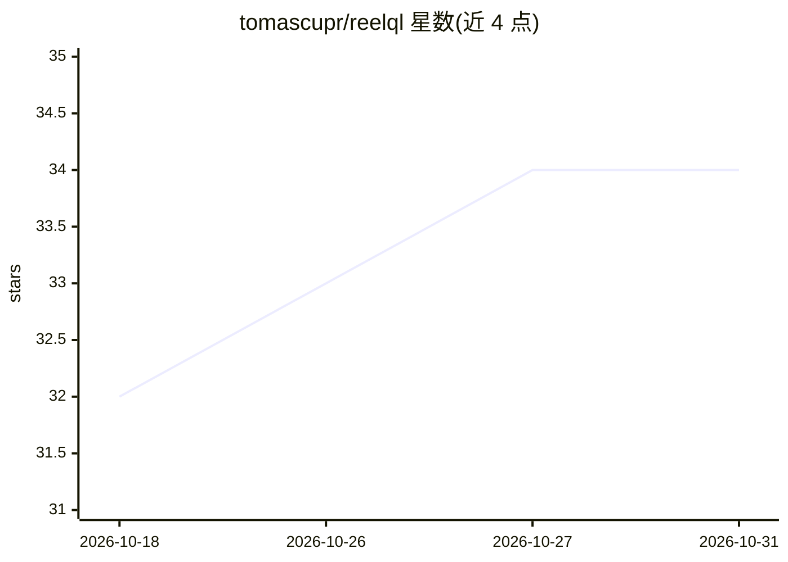

# tomascupr/reelql

⭐ 34 · HTML · MIT · 推送 2026-10-09 · [GitHub](https://github.com/tomascupr/reelql) · 个人维护

**视频链接转结构化 JSON 的分析 API，配 Claude 技能**

输入任意公开视频链接（yt-dlp 可抓取的平台或直链媒体文件），输出一份带时间戳的类型化 JSON 文档，含摘要、章节、场景、人物、关键时刻、情绪弧线、品牌、屏幕文字与说话人标注的转写。以 REST API 提供，并打包为 Claude Code 技能/claude.ai 技能，可配合 TypeSafe 的 Jev 判别模型做广告排名与品牌安全判断。运行于作者自建的单 GPU 服务器，开源模型推理，按视频分钟数预付计费（$0.05/分钟），单视频上限 30 分钟/4GB，结果保留一天。

## 筛选速览

| 维度 | 判定 | 备注 |
|---|---|---|
| AI 角色 | `ai-native` | 本体是模型或模型工具 |
| 许可风险 | `permissive` | MIT |
| 部署形态 | `desktop` | 安装包/桌面程序 |
| 模型依赖 | — | README 未给出锁定关系 |
| 硬件要求 | — | 无带数字的原话,不猜 |
| 安装摩擦 | `low` | 无编译、无系统依赖或容器化 |
| 成熟度 | — | 结构信号不足 |

## 能力要点

- 视频链接→单一类型化 JSON（摘要/场景/情绪弧线/品牌/转写等，全部带时间戳）
- 提供 Claude Code 插件与 claude.ai 技能包，以及纯 HTTP API
- 内置 scripts/jev.py 配合 Jev 模型做逐字段打分与批量排序
- 支持 TikTok 图文帖按幻灯片读取，情绪弧线取自 21 种固定情绪列表

## 适用场景

- 让 agent 分析 TikTok/YouTube 视频并基于结构化字段做分支决策
- 批量按 brief 排名品牌广告视频
- 对视频内容做品牌安全与产品声明核验

## 场景标签

`多模态` · 领域:感知与多模态

## 证据(README 行号)

> L5: Paste any video link and get back one typed JSON document: summary, chapters, scenes, cast, key moments, the emotion
> L127: The analysis runs on open models on our own GPUs, with no third-party AI APIs.

## 星数曲线

2026-10-18 32 → 2026-10-31 34（+2）

---
*卡片 v1 · prompt 1.4 · 生成 2026-10-25 · 置信度 mid · 依据 README sha `43174d606a78` · [字段定义](../../DATASET.md)*
