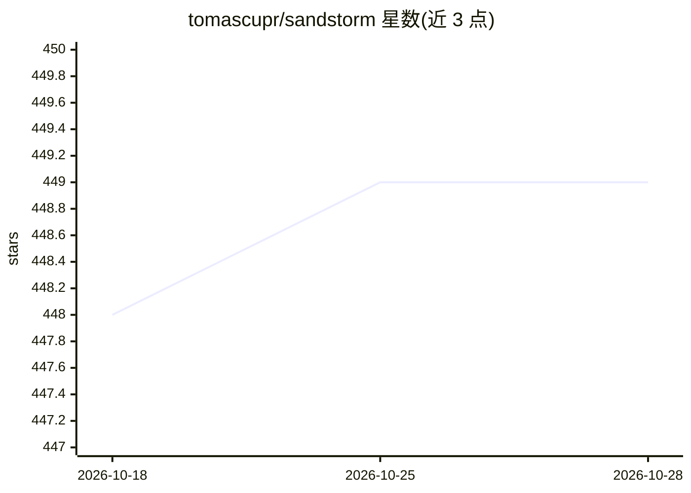

# tomascupr/sandstorm

⭐ 449 · Python · MIT · 推送 2026-04-24 · [GitHub](https://github.com/tomascupr/sandstorm) · [官网](https://duvo.ai) · 个人维护

**自托管沙箱化 Agent 运行时：在自有基础设施上经 Slack/API/CLI 运行 Claude 等 Agent**

将 Claude Agent SDK 或任意 LLM 封装为沙箱化 Agent 的自托管运行时，提供 CLI、HTTP API、Python 客户端与 Slack bot。每个线程获得独立沙箱（默认 E2B，可自托管），支持流式输出、文件上传、会话恢复与回放、OpenTelemetry 追踪导出。多供应商接入：Anthropic 直连、OpenRouter、Vertex AI、Bedrock、Azure Foundry 及任意 OpenAI 兼容端点。附带 8 个 starter 模板、MCP 工具包安装、cron/webhook/表情触发与个人/团队记忆命令。MIT 许可，pip 安装，可部署于 Railway/Docker/K8s。

## 筛选速览

| 维度 | 判定 | 备注 |
|---|---|---|
| AI 角色 | `ai-ecosystem` | LLM/agent 周边工具 |
| 许可风险 | `permissive` | MIT |
| 部署形态 | `self-host` | docker 或自建部署 |
| 模型依赖 | locked-api |  |
| 硬件要求 | — | 无带数字的原话,不猜 |
| 安装摩擦 | `low` | 无编译、无系统依赖或容器化 |
| 成熟度 | — | 结构信号不足 |

## 能力要点

- 每线程独立沙箱，文件与安装的包跨消息持久（默认 E2B，可自托管）
- 多供应商：Anthropic、OpenRouter、Vertex AI、Bedrock、Azure Foundry、任意 OpenAI 兼容端点
- OTel 追踪导出至 Langfuse/Phoenix/Langsmith 或任意 OTLP 后端
- ds replay 以不同模型复刻同一运行并报告成本/延迟差异

## 适用场景

- 在 Slack 中运行带沙箱隔离的 Claude 风格 Agent 而不把流量发给厂商托管设施
- 用 GPT-5/Gemini/DeepSeek 等模型复用 Claude Agent SDK 的工具与沙箱机制
- 把 Agent 运行遥测导出到自有可观测性后端
- 通过 cron/webhook/Slack 表情反应自动触发 Agent 任务

## 场景标签

`Agent 框架` `LLM 可观测性` · 领域:Agent 开发

## 证据(README 行号)

> L5: CLI, HTTP API, Python client, Slack bot, and repo-local TypeScript client source over
> L59: 2. **Every LLM**: Anthropic direct, OpenRouter (GPT-5, Gemini, DeepSeek, Qwen, Kimi,
> L61: 3. **Your observability**: OTel export to Langfuse,

## 星数曲线

2026-10-18 448 → 2026-10-28 449（+1）

---
*卡片 v1 · prompt 1.4 · 生成 2026-10-21 · 置信度 high · 依据 README sha `93dd7d6db137` · [字段定义](../../DATASET.md)*
