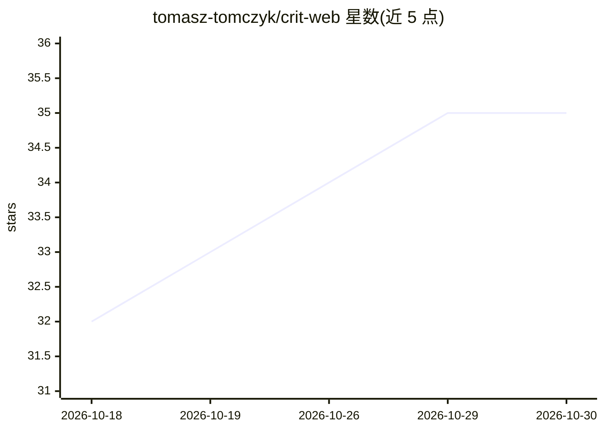

# tomasz-tomczyk/crit-web

⭐ 35 · Elixir · MIT · 推送 2026-10-26 · [GitHub](https://github.com/tomasz-tomczyk/crit-web) · [官网](https://crit.md) · 个人维护

**Crit CLI 的托管分享服务：将 AI agent 审查结果发布为公开网页**

crit-web 是本地优先 CLI 工具 Crit 的配套 Web 服务：用户在 crit CLI 中审查 AI agent 输出并添加行内评论后，点击 Share 即把评论文档上传至此，生成无需安装即可访问的公开链接，接收方可在网页上查看行内评论、键盘导航与主题切换，并可通过 CLI 撤销发布。面向希望自托管该服务的运维者/开发者，提供 docker run 与 Docker Compose 两种部署方式，依赖 PostgreSQL 17+，支持 GitHub/OIDC 登录、SMTP 通知与预览模式隔离；评论 30 天不活跃后自动过期。

## 筛选速览

| 维度 | 判定 | 备注 |
|---|---|---|
| AI 角色 | `ai-ecosystem` | LLM/agent 周边工具 |
| 许可风险 | `permissive` | MIT |
| 部署形态 | `self-host` | docker 或自建部署 |
| 模型依赖 | — | README 未给出锁定关系 |
| 硬件要求 | — | 无带数字的原话,不猜 |
| 安装摩擦 | `low` | 无编译、无系统依赖或容器化 |
| 成熟度 | — | 结构信号不足 |

## 能力要点

- 接收 crit CLI 上传的审查文档并生成公开分享链接，无需安装
- 支持 Docker 与 Docker Compose 自托管，迁移自动运行
- 支持 GitHub OAuth 与通用 OIDC/OAuth2 登录、SMTP 讨论通知摘要
- 预览模式可用独立主机隔离用户脚本的 iframe

## 适用场景

- 团队内自托管 Crit 审查结果的分享站点
- 把 AI agent 输出的审查评论以链接形式发给协作者查看
- 在私有环境中管理审查数据的托管与过期（30 天自动过期）

## 场景标签

 · 领域:开发工具/Web 服务

## 证据(README 行号)

> L8: The hosted share target for Crit - a local-first CLI for reviewing AI agent output with inline comments.
> L10: When you click **Share** in the crit CLI, your review (document + comments) is uploaded here and a public link is g

## 星数曲线

2026-10-18 32 → 2026-10-30 35（+3）

---
*卡片 v1 · prompt 1.4 · 生成 2026-10-25 · 置信度 high · 依据 README sha `de46a810876a` · [字段定义](../../DATASET.md)*
