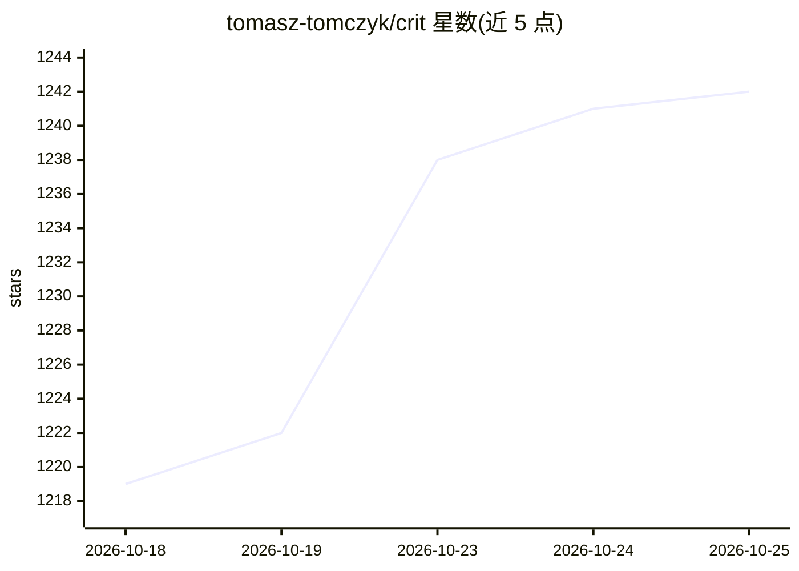

# tomasz-tomczyk/crit

⭐ 1,242 · Go · MIT · 推送 2026-10-23 · [GitHub](https://github.com/tomasz-tomczyk/crit) · [官网](https://crit.md) · 个人维护

**在浏览器中审阅 AI 编码 agent 的计划、diff 与运行中应用的工具**

本地优先的单一二进制 CLI：将 agent 产出的 markdown 计划渲染为可评论页面、把 git 变更显示为语法高亮 diff、代理运行中的开发服务器或静态 HTML 并叠加评论层。点击行号留评论后，agent 通过集成命令读取反馈并继续修改，形成审阅循环。支持 Claude Code、Cursor、Copilot 等十余种 agent 集成，提供 GitHub PR/GitLab MR 双向同步、异步分享 URL 与可选的 LLM 驱动 story mode（单独计费）。

## 筛选速览

| 维度 | 判定 | 备注 |
|---|---|---|
| AI 角色 | `ai-ecosystem` | LLM/agent 周边工具 |
| 许可风险 | `permissive` | MIT |
| 部署形态 | `desktop` | 安装包/桌面程序 |
| 模型依赖 | — | README 未给出锁定关系 |
| 硬件要求 | — | 无带数字的原话,不猜 |
| 安装摩擦 | `low` | 无编译、无系统依赖或容器化 |
| 成熟度 | — | 结构信号不足 |

## 能力要点

- plan/diff/运行中应用/静态 HTML 各自独立的审阅 UI
- 行级与范围评论，agent 可经 `crit comment` 程序化添加评论
- GitHub PR 与 GitLab MR 评论双向同步（pull/push）
- 分享审阅生成公开 URL，支持多人彩色标注评论

## 适用场景

- 让 AI 编码 agent 完成工作后，我点行留评论并让它按反馈修改
- 把 agent 的计划文档在浏览器里逐条批注再交给它执行
- 对运行中的开发服务器页面直接圈点问题反馈给 agent
- 把审阅分享给同事做异步二次评审，再同步回 GitHub/GitLab

## 场景标签

`代码审查` · 领域:编码与开发

## 证据(README 行号)

> L8: Review your coding agent's plans, diffs and running apps in the browser. Click a line, leave a comment, and the agen
> L60: Crit also works with Cursor, GitHub Copilot, OpenCode, OMO, omp, Codex, Gemini, Qwen, Hermes, Windsurf, Cline, Grok

## 星数曲线

2026-10-18 1,219 → 2026-10-25 1,242（+23）

---
*卡片 v1 · prompt 1.4 · 生成 2026-10-21 · 置信度 mid · 依据 README sha `4fa86eb20010` · [字段定义](../../DATASET.md)*
