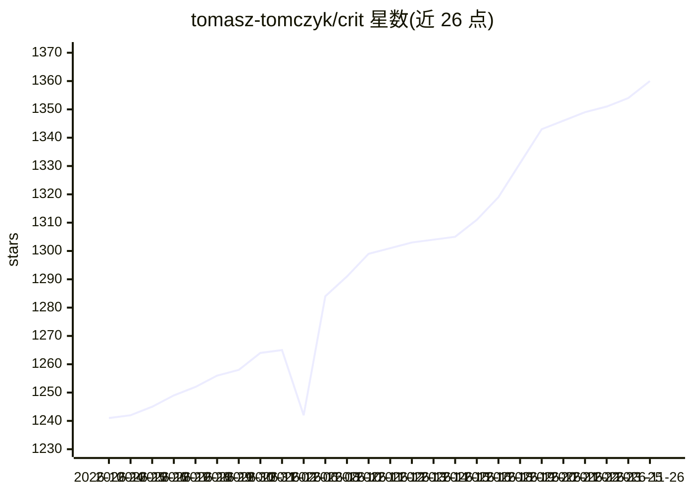

# tomasz-tomczyk/crit

⭐ 1,360 · Go · MIT · 推送 2026-11-25 · [GitHub](https://github.com/tomasz-tomczyk/crit) · [官网](https://crit.md) · 个人维护

**为编码 agent 的计划、diff 与运行应用提供浏览器内评审的本地工具**

以单一二进制本地运行的评审工具：对 markdown 计划文件、git 变更 diff、静态 HTML、Excalidraw 图以及经代理的运行中开发服务器分别提供对应形式的浏览器评审 UI，用户点击行或元素留评论，agent 读取评论文件后继续迭代。支持 /crit 斜杠命令自动循环、story mode 分章解读大 diff（LLM 驱动、另行计费）、cookie 转发的 live 代理模式、crit comment 程序化评论、公开链接分享，以及与 GitHub PR/GitLab MR 的双向评论同步。

## 筛选速览

| 维度 | 判定 | 备注 |
|---|---|---|
| AI 角色 | `ai-ecosystem` | LLM/agent 周边工具 |
| 许可风险 | `permissive` | MIT |
| 部署形态 | `desktop` | 安装包/桌面程序 |
| 模型依赖 | locked-api |  |
| 硬件要求 | — | 无带数字的原话,不猜 |
| 安装摩擦 | `low` | 无编译、无系统依赖或容器化 |
| 成熟度 | — | 结构信号不足 |

## 能力要点

- 按输出类型适配的评审 UI：计划 markdown、git diff、静态 HTML、Excalidraw、运行中应用代理
- 点击行/拖选范围留内联评论，agent 读取后继续修改，可循环至通过
- /crit 斜杠命令自动化评审循环；story mode 对大 PR 生成分章概览（LLM 驱动）
- GitHub PR 与 GitLab MR 双向评论同步，支持自托管 GitLab

## 适用场景

- 让编码 agent 写完计划或改完代码后，在浏览器里逐行评审并反馈
- 评审 agent 正在开发的本地运行 Web 应用（代理加评审层）
- 大分支/PR 先用 story mode 了解变更结构再逐行评审
- 通过分享链接让同事异步补充意见后再交给 agent

## 场景标签

`代码审查` · 领域:编码与开发

## 证据(README 行号)

> L8: Review your coding agent's plans, diffs and running apps in the browser. Click a line, leave a comment, and the agen
> L67: Crit also works with Cursor, GitHub Copilot, OpenCode, OMO, omp, Codex, Gemini, Qwen, Hermes, Windsurf, Cline, Grok
> L71: Most integrations include a `/crit` slash command that automates the full review loop.

## 星数曲线

2026-10-24 1,241 → 2026-11-26 1,360（+119）

---
*卡片 v1 · prompt 1.4 · 生成 2026-11-26 · 置信度 mid · 依据 README sha `ac9dc13c16da` · [字段定义](../../DATASET.md)*
