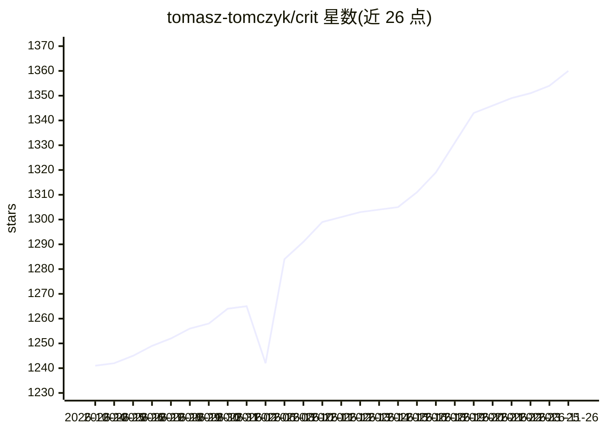

# tomasz-tomczyk/crit

⭐ 1,360 · Go · MIT · 推送 2026-11-25 · [GitHub](https://github.com/tomasz-tomczyk/crit) · [官网](https://crit.md) · 个人维护

**开发者在浏览器中审查 AI agent 的计划、diff 与运行中的应用**

一个本地运行的 CLI 工具，为 AI coding agent 产出提供浏览器审查界面：markdown 计划文件渲染注释、git 变更显示为 diff、dev server 经代理叠加审查层、静态 HTML 与 Excalidraw 画布支持点选评论。通过 /crit 斜杠命令集成到多种 agent，agent 启动 Crit、等待评论后据此修改，循环至通过。story mode 由 LLM 生成分章概览（额外 LLM 开销），Share 功能可上传生成公开 URL，支持 GitHub PR / GitLab MR 双向评论同步。

## 筛选速览

| 维度 | 判定 | 备注 |
|---|---|---|
| AI 角色 | `ai-ecosystem` | LLM/agent 周边工具 |
| 许可风险 | `permissive` | MIT |
| 部署形态 | `desktop` | 安装包/桌面程序 |
| 模型依赖 | — | README 未给出锁定关系 |
| 硬件要求 | — | 无带数字的原话,不猜 |
| 安装摩擦 | `low` | 无编译、无系统依赖或容器化 |
| 成熟度 | — | 结构信号不足 |

## 能力要点

- 为计划/diff/运行应用/HTML/Excalidraw 各类型输出提供专属审查 UI
- 本地运行的单二进制，支持 brew/go/nix/Arch/Windows 多渠道安装
- /crit 命令自动化审查循环，评论直接回传给 agent
- GitHub PR 与 GitLab MR 评论双向同步

## 适用场景

- 让 AI agent 改代码后逐行审查 diff 并留评论
- 审查 agent 写的技术方案文档
- 代理审查正在运行的本地 dev server 界面
- 把评审链接分享给他人异步提意见

## 场景标签

`代码审查` · 领域:编码与开发

## 证据(README 行号)

> L8: Review your coding agent's plans, diffs and running apps in the browser. Click a line, leave a comment, and the agen
> L67: Crit also works with Cursor, GitHub Copilot, OpenCode, OMO, omp, Codex, Gemini, Qwen, Hermes, Windsurf, Cline, Grok
> L24: Everything runs locally from a single binary.

## 星数曲线

2026-10-24 1,241 → 2026-11-26 1,360（+119）

---
*卡片 v1 · prompt 1.4 · 生成 2026-11-23 · 置信度 mid · 依据 README sha `007392a3c21c` · [字段定义](../../DATASET.md)*
