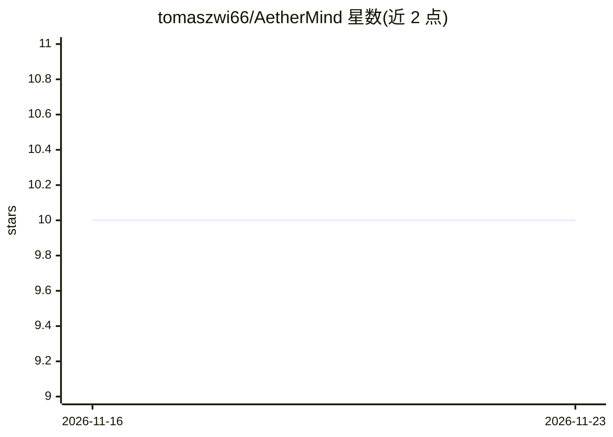

# tomaszwi66/AetherMind

⭐ 10 · Python · MIT · 推送 2026-04-15 · [GitHub](https://github.com/tomaszwi66/AetherMind) · [官网](https://tomaszwi66.github.io/) · 个人维护

**本地运行的个人记忆系统：对你的生活数据做 RAG 问答**

采集 git 提交、笔记、Google Calendar、位置历史等个人数据，用本地 LLM 与嵌入模型生成语义记忆，提供增量同步与内容哈希去重。用户通过 Streamlit UI 或 ask.py CLI 以自然语言查询自己的历史，并有每日 AI 反思生成总结与模式检测。所有数据处理在本机完成，无需 API key；安装需 Python 3.11+、Ollama，嵌入默认在 CUDA GPU 上运行。

## 筛选速览

| 维度 | 判定 | 备注 |
|---|---|---|
| AI 角色 | `ai-native` | 本体是模型或模型工具 |
| 许可风险 | `permissive` | MIT |
| 部署形态 | `None` |  |
| 模型依赖 | local-ok | 支持本地模型 |
| 硬件要求 | — | 无带数字的原话,不猜 |
| 安装摩擦 | `medium` | 含编译或系统依赖之一 |
| 成熟度 | — | 结构信号不足 |

## 能力要点

- 自动采集 git 提交、笔记、Google Calendar 与 Google Takeout 位置历史
- 本地 LLM 生成每日反思（总结、风险、模式检测）
- 语义记忆问答 CLI 与 Streamlit UI（Timeline/Ask/Reflections/Stats）
- 通过 Windows 任务计划程序配置每日自动化任务

## 适用场景

- 用自然语言查询自己过去的工作产出与日程
- 本地汇总分散在 git 仓库和笔记中的个人数据
- 生成每日生活数据的自动总结

## 场景标签

`知识库管理` `RAG` · 领域:知识与检索

## 证据(README 行号)

> L6: AetherMind is a personal cognitive infrastructure: it collects data from your life (git commits, notes, calendar, lo
> L14: - **Semantic memory search** - ask "when was I most productive?" and get answers from your actual history
> L15: - **Daily AI reflection** - local LLM generates daily summaries, wins, risks, and pattern detection

## 星数曲线

2026-11-16 10 → 2026-11-23 10（+0）

---
*卡片 v1 · prompt 1.4 · 生成 2026-11-19 · 置信度 high · 依据 README sha `de603dd2bf55` · [字段定义](../../DATASET.md)*
