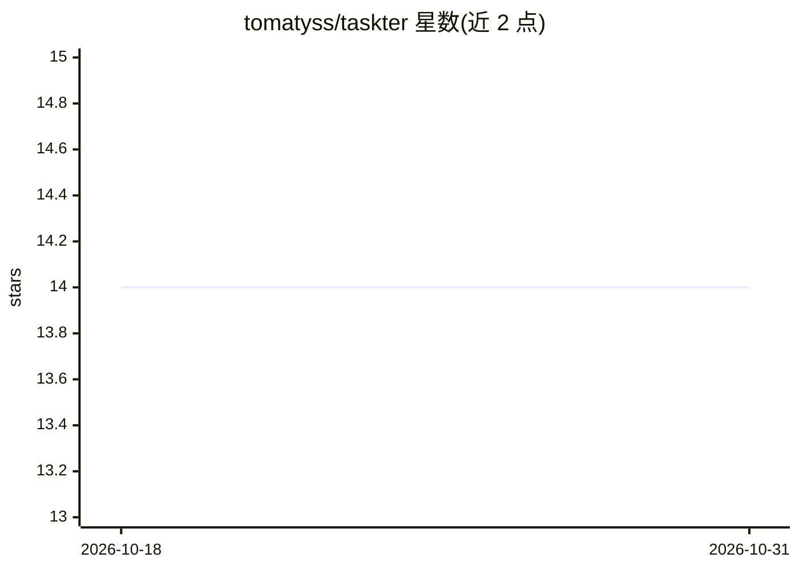

# tomatyss/taskter

⭐ 14 · Rust · MIT · 推送 2026-03-11 · [GitHub](https://github.com/tomatyss/taskter) · [官网](https://tomatyss.github.io/taskter/) · 个人维护

**终端看板 CLI：把 LLM agent 指派到任务并调度执行**

用 Rust 编写的终端 Kanban 板工具：任务分 ToDo/InProgress/Done 三列，支持项目描述、操作日志与 OKR 管理。可创建 LLM agent（配置 prompt、工具、模型、provider），将任务指派给 agent 执行，agent 通过模型请求与本地工具调用循环完成任务，失败则退回待办并留评论。内置 cron 表达式的 agent 调度器与并行执行、minimal MCP server（stdio）、10 个内置工具（run_bash、文件操作、邮件、web_search 等）。模型 provider 层支持 Gemini/OpenAI/Ollama。项目自述为 pre-alpha 状态，可能有破坏性变更。

## 筛选速览

| 维度 | 判定 | 备注 |
|---|---|---|
| AI 角色 | `ai-ecosystem` | LLM/agent 周边工具 |
| 许可风险 | `permissive` | MIT |
| 部署形态 | `desktop` | 安装包/桌面程序 |
| 模型依赖 | local-ok | 支持本地模型 |
| 硬件要求 | — | 无带数字的原话,不猜 |
| 安装摩擦 | `low` | 无编译、无系统依赖或容器化 |
| 成熟度 | `idea` | |

## 能力要点

- 任务指派给 LLM agent 执行，工具调用循环本地运行
- cron 表达式 agent 调度器与并行任务执行
- minimal MCP server（stdio）向 MCP 客户端暴露工具
- 内置 10 个工具：run_bash/run_python/文件操作/邮件/web_search 等

## 适用场景

- 在终端看板上管理任务并由 AI agent 代为执行
- 通过 cron 定时调度 agent 周期性执行任务
- 把 Taskter 工具接入 IDE 等 MCP 客户端

## 场景标签

`Agent 框架` `工作流自动化` · 领域:Agent 开发

## 证据(README 行号)

> L284: Taskter now supports LLM-based agents that can be assigned to tasks. These agents can execute tasks using the conf
> L336: 1. Taskter builds a conversation history from the agent prompt and the selected task, then asks the configured pro
> L358: #### Model Providers (Gemini + OpenAI + Ollama)

## 星数曲线

2026-10-18 14 → 2026-10-31 14（+0）

---
*卡片 v1 · prompt 1.4 · 生成 2026-10-31 · 置信度 high · 依据 README sha `4f25eda32777` · [字段定义](../../DATASET.md)*
