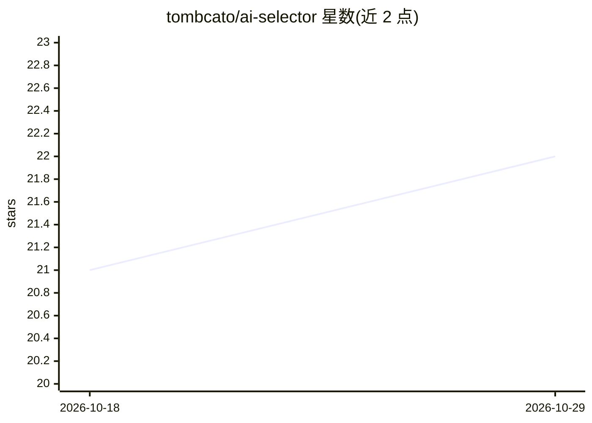

# tombcato/ai-selector

⭐ 22 · TypeScript · MIT · 推送 2026-01-03 · [GitHub](https://github.com/tombcato/ai-selector) · [官网](https://tombcato.github.io/ai-selector/) · 个人维护 · 中文 README

**给 Web 应用嵌入的 LLM 厂商/模型配置 UI 组件（React/Vue）**

面向需要用户自备 AI 配置的应用开发者的 TypeScript 组件库：提供 AIConfigForm 表单组件与 useAIConfig Hook，内置 20+ 厂商预设（OpenAI/Claude/Gemini/DeepSeek/Ollama 等），支持自动拉取模型列表、连接测试与延迟诊断，API Key 以 AES 加密存入 localStorage。提供前端直连、后端代理（附 backend/server.py）与自定义 ModelFetcher 三种接入方式，另有完全自定义 UI 的 Headless 模式。核心包框架无关，React/Vue 双适配器共享逻辑。限制：默认加密密钥固定，不适用于高安全场景；直连模式 API Key 暴露于浏览器。

## 筛选速览

| 维度 | 判定 | 备注 |
|---|---|---|
| AI 角色 | `ai-ecosystem` | LLM/agent 周边工具 |
| 许可风险 | `permissive` | MIT |
| 部署形态 | `library` | 以包/库形式分发 |
| 模型依赖 | local-ok | 支持本地模型 |
| 硬件要求 | — | 无带数字的原话,不猜 |
| 安装摩擦 | `low` | 无编译、无系统依赖或容器化 |
| 成熟度 | — | 结构信号不足 |

## 能力要点

- 内置 20+ 厂商预设，支持自动模型发现与自定义厂商扩展
- React/Vue 双框架适配器，核心逻辑框架无关
- Headless 模式（useAIConfig Hook）完全自定义 UI
- API Key AES 加密存储到 localStorage；直连/代理/自定义 fetcher 三种接入方式

## 适用场景

- 我的应用需要让用户自己填 AI 厂商和 API Key，想直接嵌入一个配置表单
- BYOK（用户自带 Key）场景下测试 API 连通性与拉取可用模型
- 生产环境通过后端代理隐藏 API Key 并绕过 CORS

## 场景标签

 · 领域:前端 UI 组件/LLM 接入

## 证据(README 行号)

> L6:  如果你开发的应用/服务需要用户提供 AI 配置，试试 AI Selector 聚合配置和连接处理， 开箱即用，为 React 和 Vue 提供一致的 AI 服务接入体验
> L57: |🧩 **Headless 模式**|只用 `useAIConfig` Hook，完全自定义 UI|

## 星数曲线

2026-10-18 21 → 2026-10-29 22（+1）

---
*卡片 v1 · prompt 1.4 · 生成 2026-10-28 · 置信度 mid · 依据 README sha `89583e5f6be2` · [字段定义](../../DATASET.md)*
