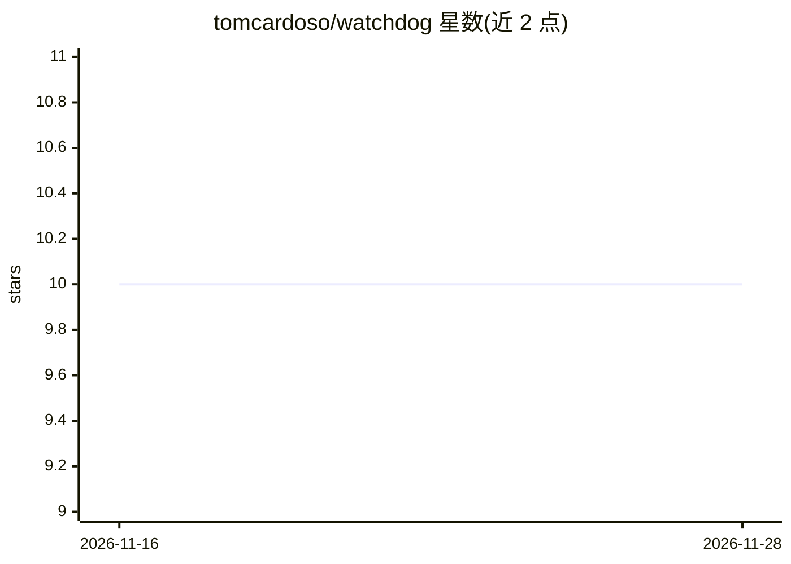

# tomcardoso/watchdog

⭐ 10 · Python · MIT · 推送 2026-11-27 · [GitHub](https://github.com/tomcardoso/watchdog) · [官网](https://tomcardoso.github.io/watchdog/) · 个人维护

**给记者的桌面文档情报应用：投入记录，发现关联**

面向积累大量公共记录（法庭文件、企业记录、信息公开回复、土地登记等）的记者的桌面应用：将文档拖入调查项目后，应用在本地读取、OCR 和转换每页内容，用大语言模型抽取人物、公司、地址、关系与日期，构建可检索、可提问的关联网络，每个事实都标注出处页码。文档转换与录音转写本地运行，原文不离开电脑；抽取文本发送至云端 AI 模型分析，故仅适用于公共或推定公开的文件。每项调查为本地 Markdown 文件夹，可用 Obsidian 打开。

## 筛选速览

| 维度 | 判定 | 备注 |
|---|---|---|
| AI 角色 | `ai-native` | 本体是模型或模型工具 |
| 许可风险 | `permissive` | MIT |
| 部署形态 | `desktop` | 安装包/桌面程序 |
| 模型依赖 | locked-api |  |
| 硬件要求 | — | 无带数字的原话,不猜 |
| 安装摩擦 | `low` | 无编译、无系统依赖或容器化 |
| 成熟度 | — | 结构信号不足 |

## 能力要点

- 读取 PDF（含扫描件自动 OCR）、Word、表格、图片、网页、音视频，录音本地转写并带可点击时间戳
- 实体与关系抽取为链接笔记，事实附页级引用；日期事件汇总为时间线视图
- 标记文档间矛盾与重复线索；内置 33 种文档类型指南
- 每项调查为本地 Markdown 文件夹，可用 Obsidian 打开与批注

## 适用场景

- 整理法庭文件与企业记录，梳理人物与公司的关联网络
- 对一批 FOIA 回复提问，答案附页码引用以便核实
- 从多份文档构建调查时间线并发现矛盾点

## 场景标签

`知识库管理` `语音识别` `文档解析` `文档问答` · 领域:知识与检索

## 证据(README 行号)

> L10: Watchdog is a desktop app for journalists who accumulate large sets of public records — court filings, corporate re
> L12: Each investigation is a folder of ordinary Markdown files on your computer, which you can also open in Obsidian, a 
> L60: - Claude access — we recommend an Anthropic API key for reading documents (roughly US$1 per 1,000 pages with the de

## 星数曲线

2026-11-16 10 → 2026-11-28 10（+0）

---
*卡片 v1 · prompt 1.4 · 生成 2026-11-19 · 置信度 high · 依据 README sha `a1683e670473` · [字段定义](../../DATASET.md)*
