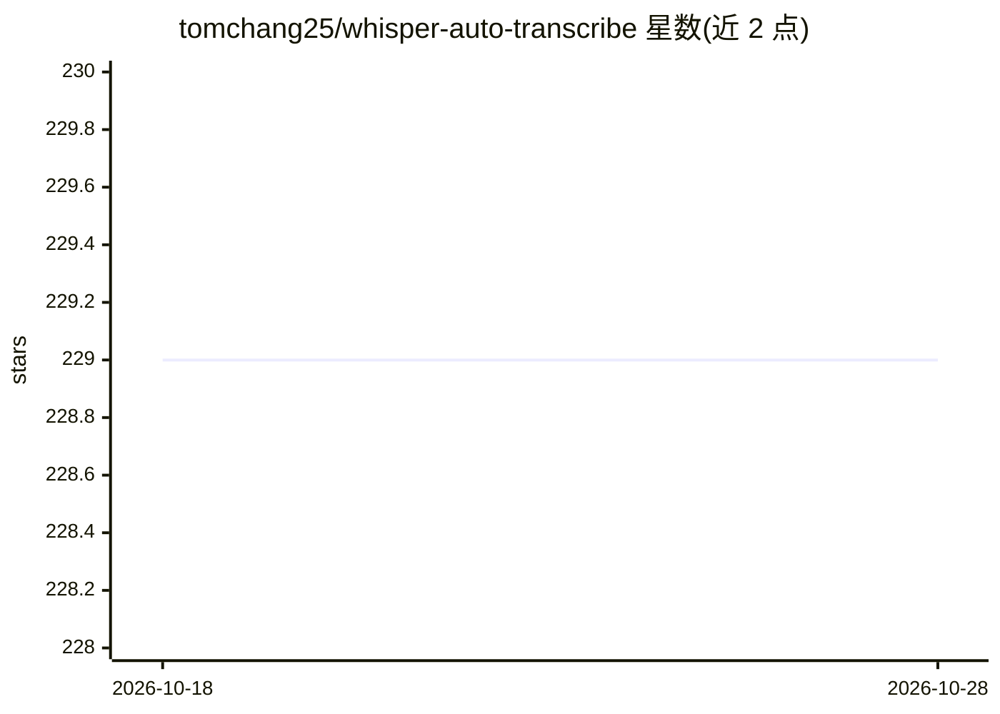

# tomchang25/whisper-auto-transcribe

⭐ 229 · Python · MIT · 推送 2026-05-05 · [GitHub](https://github.com/tomchang25/whisper-auto-transcribe) · 个人维护

**为视频/音频自动生成与翻译字幕的 Whisper 工具**

基于 OpenAI Whisper 的字幕生成工具：对视频或音频自动转录并生成字幕，支持翻译为英文、99 种语言、GPU（CUDA）加速与 CLI 模式；特色包括一键安装器、0.01 秒级时间精度、YouTube 集成、字幕预览、背景音乐静音处理、3 小时长文件与批量处理。以 Gradio Web UI（127.0.0.1:7860）和 CLI 两种方式运行，限制为 GPU 加速仅在 CUDA 环境下可用，且需足够显存（large 模型约 10 GB）。

## 筛选速览

| 维度 | 判定 | 备注 |
|---|---|---|
| AI 角色 | `ai-native` | 本体是模型或模型工具 |
| 许可风险 | `permissive` | MIT |
| 部署形态 | `library` | 以包/库形式分发 |
| 模型依赖 | — | README 未给出锁定关系 |
| 硬件要求 | — | 无带数字的原话,不猜 |
| 安装摩擦 | `medium` | 含编译或系统依赖之一 |
| 成熟度 | — | 结构信号不足 |

## 能力要点

- 自动生成字幕并翻译为英文，支持 99 种语言
- Gradio Web UI 与 CLI 两种使用方式
- 支持 YouTube 集成、批量处理与长文件（3 小时已测试）
- 时间精度提升至 0.01 秒，含背景音乐静音处理

## 适用场景

- 给视频或音频文件生成字幕
- 将非英语内容转录并翻译为英文字幕
- 批量处理 YouTube 视频字幕

## 场景标签

`语音识别` · 领域:感知与多模态

## 证据(README 行号)

> L45: The tool is based on OpenAI-whisper, the latest project developed by OpenAI.
> L23: - Automatically generates subtitles for video or audio content

## 星数曲线

2026-10-18 229 → 2026-10-28 229（+0）

---
*卡片 v1 · prompt 1.4 · 生成 2026-10-22 · 置信度 mid · 依据 README sha `1c572cc4ac3f` · [字段定义](../../DATASET.md)*
