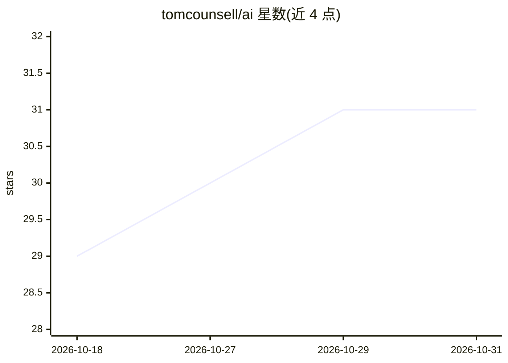

# tomcounsell/ai

⭐ 31 · Python · GPL-3.0 · 推送 2026-10-30 · [GitHub](https://github.com/tomcounsell/ai) · 个人维护

**单人运行的自主 AI 雇员系统：可纠正的 agent 内核与工作流**

Valor 是为维护者 Tom 个人定制的 AI 员工系统：一个身份通过 Telegram 对话接活，分派给前沿 agent（每次一轮 claude -p）完成从理解到交付的整段工作。关键机制是三层结构：确定性内核掌管权限（效果分级 read/propose/act、开销上限、账本、随时可停且无损失），判断层用托管模型做分类路由（开权重模型作回退），agent 层做实际工作。运行于 MacBook Air M4，用 launchd 调度、sandbox-exec 沙箱、Postgres 存储。README 是设计文档，未见对外安装步骤；设计假设均映射到对齐研究文献。

## 筛选速览

| 维度 | 判定 | 备注 |
|---|---|---|
| AI 角色 | `ai-ecosystem` | LLM/agent 周边工具 |
| 许可风险 | `viral` | GPL-3.0 |
| 部署形态 | `None` |  |
| 模型依赖 | — | README 未给出锁定关系 |
| 硬件要求 | — | 无带数字的原话,不猜 |
| 安装摩擦 | `low` | 无编译、无系统依赖或容器化 |
| 成熟度 | — | 结构信号不足 |

## 能力要点

- 确定性内核掌管权限：效果分级、预算计量、账本、可随时无损停止
- 三层架构：kernel / judgement / agents，LLM 不决定权限
- 设计假设逐条映射到对齐/AI 安全文献（RICE、Off-Switch Game 等）
- Mac 原生运行：launchd、sandbox-exec、Keychain、Postgres

## 适用场景

- 以对话方式把不完整想法委托给系统交付可用成果
- 研究可纠正性/权限边界在 agent 系统外的工程落地
- 观察效果分级与开销计量如何约束自主 agent

## 场景标签

`工作流自动化` `编码 Agent` · 领域:效率与自动化

## 证据(README 行号)

> L97: - **Kernel.** Deterministic code that holds authority: effect classes and the broker, the ledger, stop, and steerin
> L99: - **Agents.** Frontier agents do the hard work, one `claude -p` turn at a time, each inside an effect ceiling set b

## 星数曲线

2026-10-18 29 → 2026-10-31 31（+2）

---
*卡片 v1 · prompt 1.4 · 生成 2026-10-26 · 置信度 high · 依据 README sha `9cfcba346d0a` · [字段定义](../../DATASET.md)*
