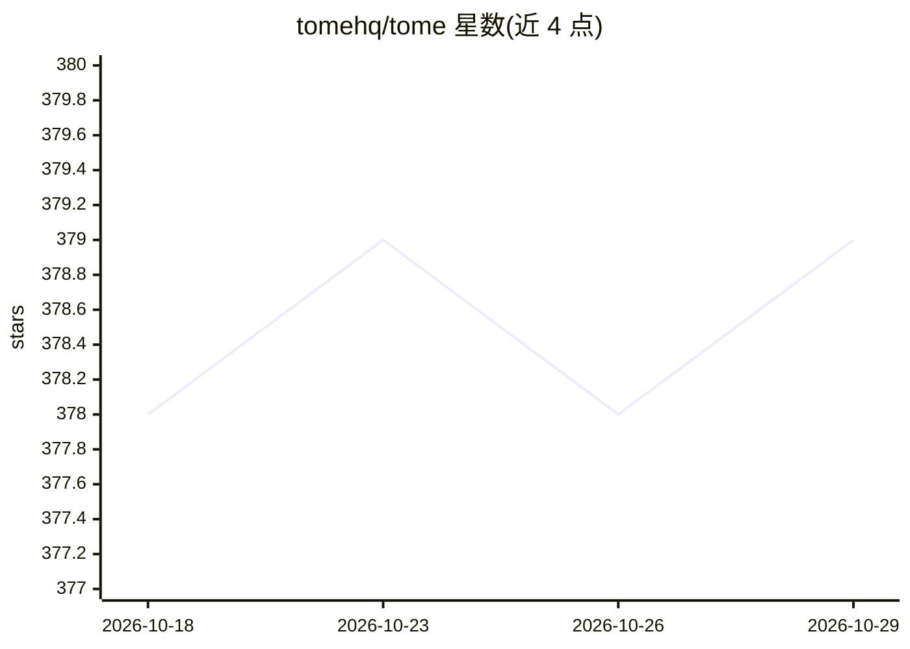

# tomehq/tome

⭐ 379 · TypeScript · MIT · 推送 2026-10-11 · [GitHub](https://github.com/tomehq/tome) · [官网](https://tome.center) · 组织维护

**面向开发者的开源自托管文档站生成平台，写 Markdown 即得文档站点**

开源文档平台：开发者编写 Markdown/MDX，生成静态文档站点，支持免费自托管或部署到 Tome Cloud。功能包括 Shiki 语法高亮、Pagefind/Algolia 搜索、从 OpenAPI 规范自动生成 API 参考页、内容源可从 GitHub/Notion/自定义 API 拉取、多语言与多版本文档、GitHub Actions CI/CD。AI 相关功能为嵌入式 AI 聊天（BYOK，支持 OpenAI 与 Anthropic 密钥）与面向 AI 工具的 MCP server 输出。提供 npx create-tome 脚手架与 tome CLI，配置文件为 tome.config.js/ts。

## 筛选速览

| 维度 | 判定 | 备注 |
|---|---|---|
| AI 角色 | `ai-enhanced` | 去掉 AI 部分产品仍成立 |
| 许可风险 | `permissive` | MIT |
| 部署形态 | `library` | 以包/库形式分发 |
| 模型依赖 | — | README 未给出锁定关系 |
| 硬件要求 | — | 无带数字的原话,不猜 |
| 安装摩擦 | `low` | 无编译、无系统依赖或容器化 |
| 成熟度 | — | 结构信号不足 |

## 能力要点

- Markdown/MDX 编写，构建为可部署到任意静态托管的文档站
- 从 OpenAPI 规范自动生成 API 参考页（含交互式 playground）
- 嵌入式 AI 聊天助手，BYOK 模式支持 OpenAI 与 Anthropic
- MCP server 输出机器可读内容供 AI 工具使用

## 适用场景

- 为软件项目搭建可自托管的 API 文档与用户文档站点
- 从 GitHub 仓库或 Notion 数据库拉取内容统一生成文档站
- 在文档站内提供基于自有 API key 的 AI 问答助手

## 场景标签

 · 领域:开发者文档/静态站点生成

## 证据(README 行号)

> L6: Tome is an open-source documentation platform for developers. Write Markdown, get a beautiful docs site. Self-host f
> L39: - **AI chat** — Embedded AI assistant with BYOK (OpenAI + Anthropic)

## 星数曲线

2026-10-18 378 → 2026-10-29 379（+1）

---
*卡片 v1 · prompt 1.4 · 生成 2026-10-21 · 置信度 high · 依据 README sha `452c306a8f2a` · [字段定义](../../DATASET.md)*
