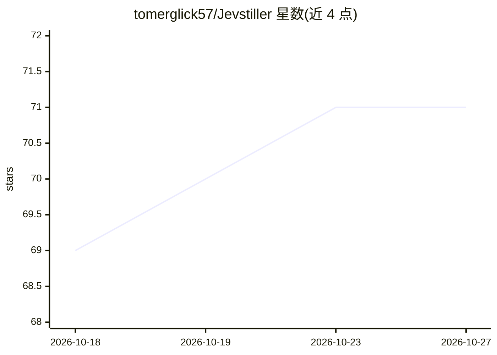

# tomerglick57/Jevstiller

⭐ 71 · Python · Apache-2.0 · 推送 2026-10-26 · [GitHub](https://github.com/tomerglick57/Jevstiller) · [官网](https://jevstiller.pages.dev) · 个人维护

**Jev 分类 API 的本地蒸馏代理：同答案，跑在自己硬件上**

放在服务与 Jev（TypeSafe 分类 API）之间的 drop-in 代理：初期请求全部转发 Jev，用其返回的完整概率分布在线训练小型本地模型（bge-small 句向量编码器 + 分类头），经 Clopper–Pearson 有限样本界校准阈值并在 2% 永久审计通道复验，达标后本地回答多数请求（~16 ms），不确定/新输入与审计样本继续转发。契约被破坏时自动回退 Jev。以 pip 包、Docker 镜像和 Kubernetes 清单提供，支持 TOML 配置、admin CLI、Prometheus 指标。限制：与 Jev 的一致性不等于准确率，Jev 错则学生同样错。

## 筛选速览

| 维度 | 判定 | 备注 |
|---|---|---|
| AI 角色 | `ai-ecosystem` | LLM/agent 周边工具 |
| 许可风险 | `permissive` | Apache-2.0 |
| 部署形态 | `self-host` | docker 或自建部署 |
| 模型依赖 | — | README 未给出锁定关系 |
| 硬件要求 | — | 无带数字的原话,不猜 |
| 安装摩擦 | `low` | 无编译、无系统依赖或容器化 |
| 成熟度 | — | 结构信号不足 |

## 能力要点

- 从 Jev 完整概率分布在线训练本地学生模型，本地回答 ~16 ms
- Clopper–Pearson 有限样本界设定一致性预算（如 98%），持续审计并自动回退
- drop-in 代理：仅改 TYPESAFE_BASE_URL，服务代码零改动
- 提供 admin CLI、Prometheus /metrics、备份与 Kubernetes 清单

## 适用场景

- 我的服务高频调用 Jev 分类，想降低延迟与费用
- 在无外网或受限速的环境下继续获得 Jev 一致的分类结果
- agent 循环、游戏 tick 等毫秒级延迟预算的分类场景

## 场景标签

`推理引擎` · 领域:训练与推理

## 证据(README 行号)

> L15: Put Jevstiller in front of a repeated Jev classification call. At first every request still goes to Jev. From Jev's
> L17:  Your services call Jevstiller instead of Jev. Most requests are answered by the local model in about 16 ms; the un
> L95: - **After that:** the proxy answers what it is sure about in Jev's exact response format (`x-jevstiller-source: loc

## 星数曲线

2026-10-18 69 → 2026-10-27 71（+2）

---
*卡片 v1 · prompt 1.4 · 生成 2026-10-24 · 置信度 high · 依据 README sha `c37add78303f` · [字段定义](../../DATASET.md)*
