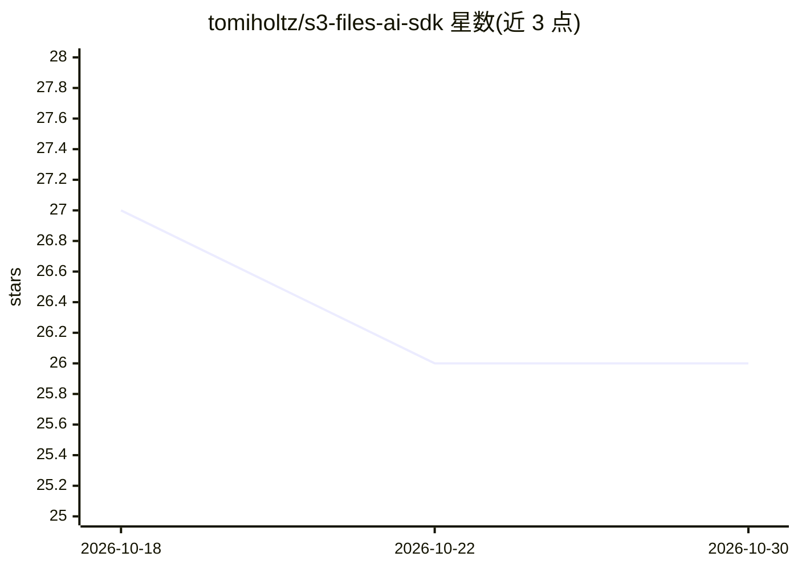

# tomiholtz/s3-files-ai-sdk

⭐ 26 · Python · MIT · 推送 2026-09-04 · [GitHub](https://github.com/tomiholtz/s3-files-ai-sdk) · 个人维护

**端侧模型推理基准评测工具：跨 delegate 汇总延迟/内存/温度**

由 Python CLI（stdlib only）与 Kotlin 设备端核心（JVM/Android，stdlib only）两部分组成的端侧推理基准工具，两部分仅通过行式文本协议（plan/sample）交互。流程为 manifest 校验 → 生成 plan（delegate×batch×threads 笛卡尔积）→ 采集样本 → 汇总为 p50/p90/p99、峰值内存、峰值温度、吞吐与降频标记的确定性报告。两侧使用相同百分位定义，输出可 diff 做回归检查。限制：Kotlin 核心未在作者环境本地编译，依赖 CI（JDK17+Gradle）构建；模板 delegate harness 等仍在路线图中。

## 筛选速览

| 维度 | 判定 | 备注 |
|---|---|---|
| AI 角色 | `ai-ecosystem` | LLM/agent 周边工具 |
| 许可风险 | `permissive` | MIT |
| 部署形态 | `None` |  |
| 模型依赖 | — | README 未给出锁定关系 |
| 硬件要求 | — | 无带数字的原话,不猜 |
| 安装摩擦 | `medium` | 含编译或系统依赖之一 |
| 成熟度 | — | 结构信号不足 |

## 能力要点

- Python/Kotlin 双侧均零第三方依赖，以文本协议交换 plan 与 sample
- 每 (model, delegate, config) 组合为一个 tile，聚合 p50/p90/p99、峰值内存/温度与降频标记
- manifest 校验非抛出式，一次列出全部错误/警告，可作 CI 门禁
- 报告为确定性 JSON，可用 jq+diff 做回归对比；多样本流可跨设备拼接合并

## 适用场景

- 为手机端模型对比 CPU/GPU/NNAPI/XNNPACK 等 delegate 的延迟与温度表现
- 把 manifest 校验接入 CI，拦截结构错误的模型清单
- 汇总设备农场多机样本流生成统一基准报告

## 场景标签

`模型评测` · 领域:评测与运维

## 证据(README 行号)

> L5:  Assemble a mosaic of on-device AI benchmarks — one tile per delegate.
> L36: |**Host CLI**|Python 3.9+|Validate manifests, build plans, aggregate samples, render reports|**stdlib only**|
> L83: | Model              | Delegate | n | p50 ms | p90 ms | p99 ms | peak MB | peak C | ips    | throttled |

## 星数曲线

2026-10-18 27 → 2026-10-30 26（-1）

---
*卡片 v1 · prompt 1.4 · 生成 2026-10-27 · 置信度 high · 依据 README sha `829a85801eb5` · [字段定义](../../DATASET.md)*
