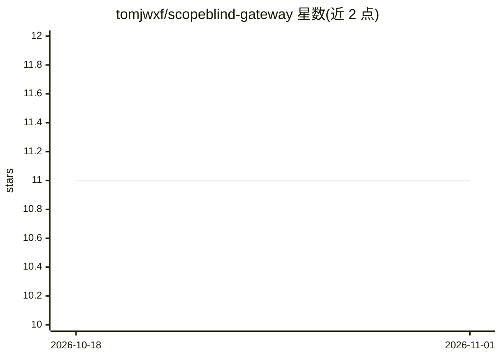

# tomjwxf/scopeblind-gateway

⭐ 11 · TypeScript · MIT · 推送 2026-07-03 · [GitHub](https://github.com/tomjwxf/scopeblind-gateway) · [官网](https://scopeblind.com) · 个人维护

**MCP 服务器安全网关：拦截工具调用，按策略放行/阻断并签发收据**

以 stdio 透明代理方式部署在 MCP 客户端与服务器之间的安全网关。默认影子模式记录全部 tools/call 请求并放行；配置策略文件后可按工具执行 block、rate_limit、min_tier 规则；运行 init 生成 Ed25519 本地签名密钥后可签发决策收据，持久化到 JSONL 并可通过 npx @veritasacta/verify 离线验证。附事件锚定的策略包、审计导出与外部策略引擎（OPA/Cerbos/Cedar/HTTP）可编程接口。README 明确列出能力边界：裸 npx 路径不自动签名，tier 准入未接入默认 CLI 路径。本仓库为个人 fork，开发已迁移至组织仓库。

## 筛选速览

| 维度 | 判定 | 备注 |
|---|---|---|
| AI 角色 | `ai-ecosystem` | LLM/agent 周边工具 |
| 许可风险 | `permissive` | MIT |
| 部署形态 | `library` | 以包/库形式分发 |
| 模型依赖 | — | README 未给出锁定关系 |
| 硬件要求 | — | 无带数字的原话,不猜 |
| 安装摩擦 | `low` | 无编译、无系统依赖或容器化 |
| 成熟度 | `idea` | |

## 能力要点

- stdio 透明代理拦截 MCP tools/call，影子模式默认全放行并记录日志
- 按工具策略：block / rate_limit / min_tier，支持 * 通配符
- Ed25519 签名决策收据，持久化 JSONL，可离线验证（npx @veritasacta/verify）
- 5 个事件锚定策略包，映射 OWASP Agentic 类别；支持 OPA/Cerbos/Cedar 外部策略引擎

## 适用场景

- 在 Claude Desktop / Cursor 等 MCP 客户端与服务器之间加装访问控制层
- 上线前以影子模式观察 agent 实际调用了哪些工具
- 为合规审计留存可独立验证的签名决策收据
- 用预设策略包阻断提示注入、数据外泄等已公开攻击路径

## 场景标签

`网络安全` · 领域:学习与行业

## 证据(README 行号)

> L7: Security gateway for MCP servers. Shadow-mode logs by default, per-tool policies, optional local Ed25519 receipts, a
> L22: protect-mcp sits between your MCP client and server as a stdio proxy:

## 星数曲线

2026-10-18 11 → 2026-11-01 11（+0）

---
*卡片 v1 · prompt 1.4 · 生成 2026-11-01 · 置信度 high · 依据 README sha `bd07ae3e5ca2` · [字段定义](../../DATASET.md)*
