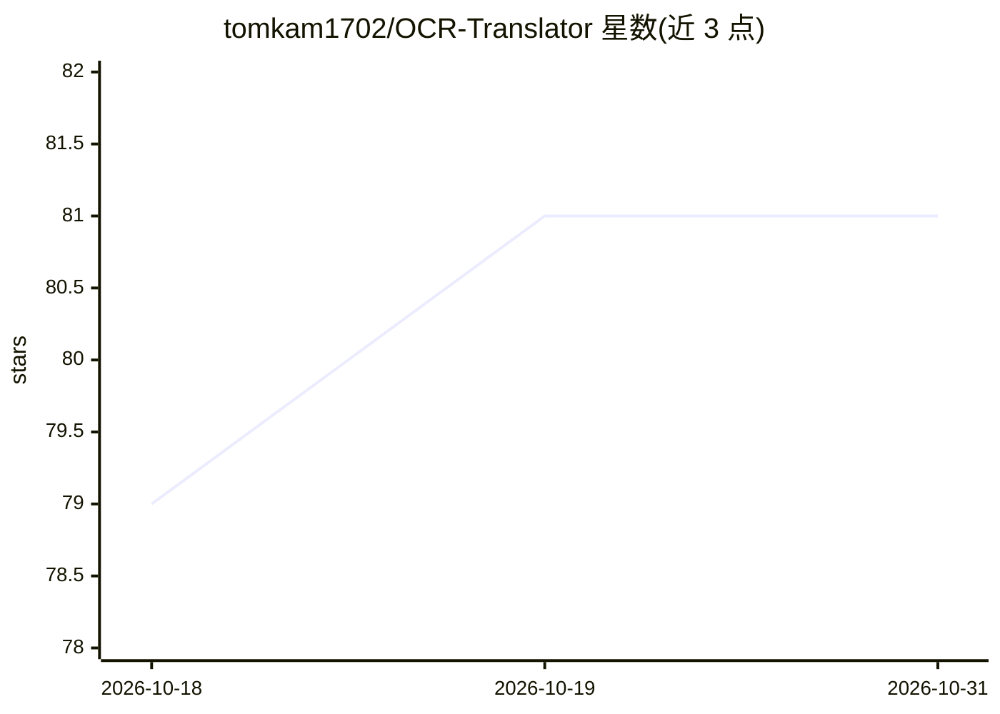

# tomkam1702/OCR-Translator

⭐ 81 · Python · NOASSERTION · 推送 2026-10-08 · [GitHub](https://github.com/tomkam1702/OCR-Translator) · [官网](https://tomkam1702.github.io/OCR-Translator/) · 个人维护

**给玩家的实时屏幕字幕翻译与离线 AI 配音桌面应用**

Game-Changing Translator (GCT) 是面向游戏/影视内容的桌面应用：通过屏幕区域截取与 AI OCR（Gemini、Gemma、Qwen）识别画面字幕，再经上下文感知翻译（Gemini、Gemma，PRO 版含 DeepL）生成目标语言悬浮字幕；v4.5 加入基于 Supertonic 3 引擎、本地 CPU（需 AVX2）运行的 31 语言神经 TTS 配音，免费版每次启动可试 3 分钟，PRO 付费解锁无限配音。v4 为纯 API 架构，需 Google 或 DeepInfra API key；无 key 用户需留在支持离线 Tesseract/MarianMT 的 v3.9.6。软件为专有 EULA，PRO 许可一次性购买，第三方 API 费用另计。

## 筛选速览

| 维度 | 判定 | 备注 |
|---|---|---|
| AI 角色 | `ai-native` | 本体是模型或模型工具 |
| 许可风险 | `none` | NOASSERTION |
| 部署形态 | `None` |  |
| 模型依赖 | — | README 未给出锁定关系 |
| 硬件要求 | — | 无带数字的原话,不猜 |
| 安装摩擦 | `low` | 无编译、无系统依赖或容器化 |
| 成熟度 | — | 结构信号不足 |

## 能力要点

- 多模型 AI OCR（Gemini/Gemma/Qwen）+ 上下文感知翻译，支持 100+ 语言
- 本地离线神经 TTS 配音（Supertonic 3，31 语言，CPU+AVX2，零 API 费用）
- PRO 版含 DeepL 翻译、自动查找字幕框、译文覆盖原字幕等功能
- 双层缓存、滑动上下文窗口（记忆前 5 条字幕）与实时成本监控

## 适用场景

- 玩外语游戏时实时翻译并朗读屏幕上的对话字幕
- 看外语影视时获得同步配音或悬浮翻译字幕
- 通过娱乐内容辅助外语学习

## 场景标签

`OCR` `语音合成` · 领域:内容生成

## 证据(README 行号)

> L11: **Game-Changing Translator (GCT)** is a state-of-the-art desktop application designed for **real-time screen transl
> L13: Powered by multi-model AI vision recognition (**Gemini**, **Gemma**, and **Qwen**), context-aware translation engin
> L85: |**💻 100% Offline & Zero API Costs**|Powered by the embedded **Supertonic 3** neural engine running entirely on you

## 星数曲线

2026-10-18 79 → 2026-10-31 81（+2）

---
*卡片 v1 · prompt 1.4 · 生成 2026-10-24 · 置信度 high · 依据 README sha `d8f150f55eff` · [字段定义](../../DATASET.md)*
