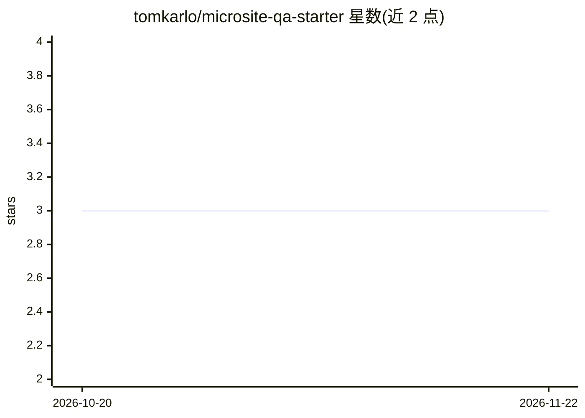

# tomkarlo/microsite-qa-starter

⭐ 3 · HTML · MIT · 推送 2026-10-14 · [GitHub](https://github.com/tomkarlo/microsite-qa-starter) · [官网](consultation.qpls.uk) · 个人维护

**面向固定文档集的单页问答站：服务端检索+Claude 生成答案**

一个单页站点加三个 serverless 函数的起步模板，针对限定文档集（如议会咨询报告、入学政策）提供问答：服务端关键词检索切片文档，Claude 基于检索结果流式生成回答，API key 不下发浏览器。内置按 IP/每日/金额三层用量上限、Upstash Redis 共享限流、SITE_MODE 暂停机制与 KEY_FACTS 关键事实兜底。明确声明不支持大规模语料，检索为关键词而非语义。

## 筛选速览

| 维度 | 判定 | 备注 |
|---|---|---|
| AI 角色 | `ai-native` | 本体是模型或模型工具 |
| 许可风险 | `permissive` | MIT |
| 部署形态 | `library` | 以包/库形式分发 |
| 模型依赖 | locked-api |  |
| 硬件要求 | — | 无带数字的原话,不猜 |
| 安装摩擦 | `low` | 无编译、无系统依赖或容器化 |
| 成熟度 | — | 结构信号不足 |

## 能力要点

- 无数据库、无构建步骤，免费部署到 Vercel
- 三层独立用量上限：按 IP、全站每日、API key 消费限额
- KEY_FACTS 关键事实随每次请求发送，弥补关键词检索遗漏
- SITE_MODE 暂停模式在非活动期停止回答与花费

## 适用场景

- 就某份政府规划或可行性研究报告向居民提供问答
- 为学校招生政策等限定文档集搭建公开答疑页
- 咨询活动结束后暂停站点，保留页面说明

## 场景标签

`文档问答` · 领域:知识与检索

## 证据(README 行号)

> L3: A one-page site that answers questions about a fixed set of documents, and nothing else.
> L4: Retrieval runs server-side over documents you supply, Claude answers from what retrieval finds,
> L12: **What it is:** one static page plus three small serverless functions, deployed free on Vercel.

## 星数曲线

2026-10-20 3 → 2026-11-22 3（+0）

---
*卡片 v1 · prompt 1.4 · 生成 2026-11-21 · 置信度 high · 依据 README sha `2a59d5de881b` · [字段定义](../../DATASET.md)*
