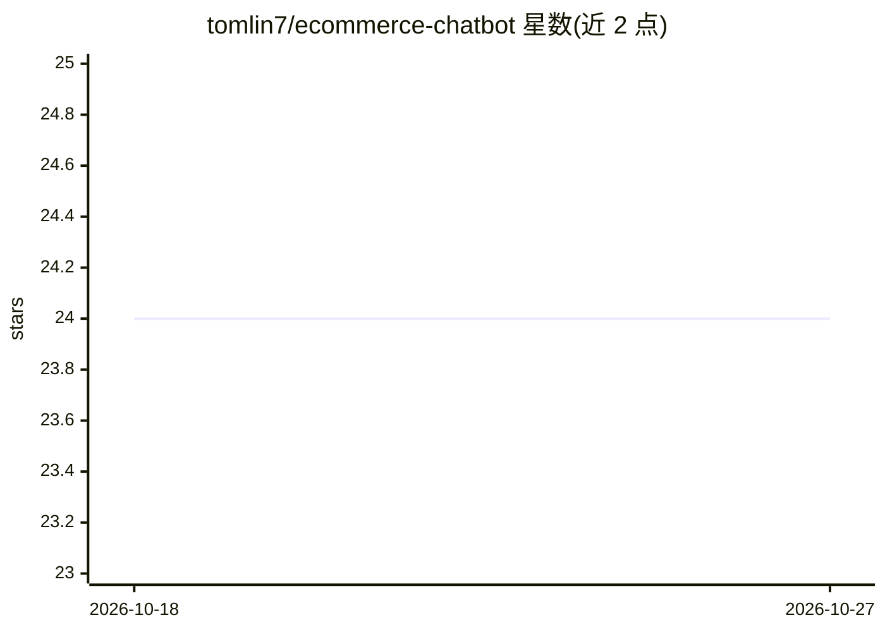

# tomlin7/ecommerce-chatbot

⭐ 24 · TypeScript · MIT · 推送 2025-12-12 · [GitHub](https://github.com/tomlin7/ecommerce-chatbot) · [官网](https://ecommerce-chatbot-one.vercel.app) · 个人维护

**带 AI 购物助手的全栈电商平台**

全栈电商项目：前端 Next.js，后端 Python，集成自然语言商品搜索与推荐、基于 Pinecone 的向量检索（按描述/用途/价格/品牌等维度找商品）、持久化购物车与实时库存管理。AI 部分使用 Google Gemini Flash 2.0（1M token 上下文）、LangChain 编排、Sentence Transformers 生成嵌入。运行需自备 Google AI Studio 与 Pinecone 的 API key。README 提供架构与技术栈说明，未见完整安装步骤。

## 筛选速览

| 维度 | 判定 | 备注 |
|---|---|---|
| AI 角色 | `ai-native` | 本体是模型或模型工具 |
| 许可风险 | `permissive` | MIT |
| 部署形态 | `None` |  |
| 模型依赖 | — | README 未给出锁定关系 |
| 硬件要求 | — | 无带数字的原话,不猜 |
| 安装摩擦 | `low` | 无编译、无系统依赖或容器化 |
| 成熟度 | — | 结构信号不足 |

## 能力要点

- 自然语言商品搜索与 AI 推荐（Gemini Flash 2.0，1M token 上下文）
- Pinecone 向量检索：按描述/用途/价格/品牌/评分找商品
- 持久化购物车、收藏、实时库存管理
- LangChain 编排对话记忆与工具调用

## 适用场景

- 用对话方式搜索和发现商品
- 获取基于用户行为的商品推荐
- 管理购物车、订单与收藏的全流程购物体验

## 场景标签

 · 领域:电商/AI 应用

## 证据(README 行号)

> L3: A full-stack e-commerce platform featuring an intelligent AI shopping assistant, vector-based product search with Pi
> L12: - Natural language product search and recommendations
> L50: - **Language Model**: Google Gemini Flash 2.0

## 星数曲线

2026-10-18 24 → 2026-10-27 24（+0）

---
*卡片 v1 · prompt 1.4 · 生成 2026-10-27 · 置信度 high · 依据 README sha `86e729f59c37` · [字段定义](../../DATASET.md)*
