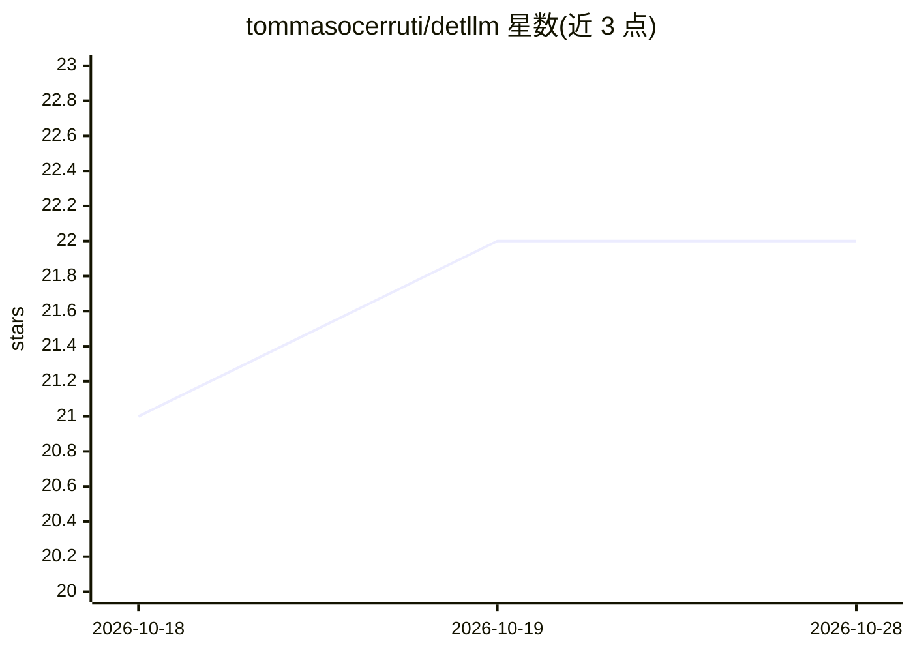

# tommasocerruti/detllm

⭐ 22 · Python · Apache-2.0 · 推送 2026-08-20 · [GitHub](https://github.com/tommasocerruti/detllm) · 个人维护

**LLM 推理确定性检验工具：测方差、定位差异原因**

面向 LLM 推理可复现性的 Python 工具：测量固定 batch 下的 run-to-run 方差与 batch-size 方差，输出逐次 trace、report 与首个分歧点 diff，构成最小复现包。提供三级能力门控保证（Tier 0 仅产物与 diff 报告，Tier 1 固定 batch 重复性，Tier 2 追加 score/logprob 相等）。CLI 覆盖 diagnose 排查可能原因、replay 定向探针、phase 扫描 batch_size/dtype 等变量划分稳定区间、analyze Wilson 置信区间与风险评分、recommend 排序后续实验（不加载模型）。已知限制：GPU 确定性依赖驱动/内核，batch 不变性仅测量不保证，分布式推理暂不在范围内。

## 筛选速览

| 维度 | 判定 | 备注 |
|---|---|---|
| AI 角色 | `ai-ecosystem` | LLM/agent 周边工具 |
| 许可风险 | `permissive` | Apache-2.0 |
| 部署形态 | `library` | 以包/库形式分发 |
| 模型依赖 | — | README 未给出锁定关系 |
| 硬件要求 | — | 无带数字的原话,不猜 |
| 安装摩擦 | `low` | 无编译、无系统依赖或容器化 |
| 成熟度 | — | 结构信号不足 |

## 能力要点

- 测量 run-to-run 与 batch-size 方差并生成最小 repro pack（trace/diff/report）
- 三级能力门控保证体系（Tier 0-2）
- phase 扫描 batch_size/dtype/max_new_tokens 划分 stable/fragile/unstable 区域
- diagnose/replay 定位输出分歧原因，analyze/recommend 输出统计与后续实验计划

## 适用场景

- 排查本地 LLM 推理两次输出不一致的原因
- 评估推理配置在不同 batch/dtype 下的可复现性风险
- 为复现实验生成含环境与 trace 的最小复现包

## 场景标签

`LLM 可观测性` · 领域:评测与运维

## 证据(README 行号)

> L20: detLLM verifies reproducibility for LLM inference and produces a minimal repro pack when outputs diverge. It measur
> L39: See docs/examples.md for runnable local workflows covering

## 星数曲线

2026-10-18 21 → 2026-10-28 22（+1）

---
*卡片 v1 · prompt 1.4 · 生成 2026-10-27 · 置信度 high · 依据 README sha `95086270fcd9` · [字段定义](../../DATASET.md)*
