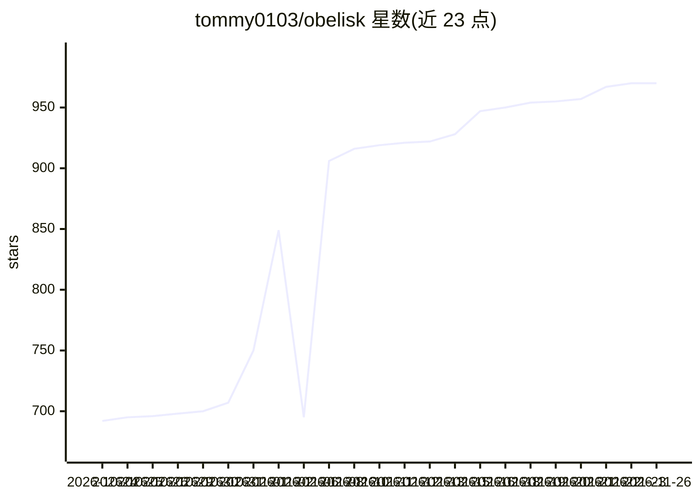

# tommy0103/obelisk

⭐ 970 · JavaScript · AGPL-3.0 · 推送 2026-11-25 · [GitHub](https://github.com/tommy0103/obelisk) · [官网](https://obelisk.antinomie.org) · 个人维护 · 中文 README

**把多个编程 agent 的历史会话索引成可查询数据库的工具**

Obelisk 将本地多个编程 agent（Claude Code、Codex、GitHub Copilot 等 12 个 provider）的会话历史索引进一个 SQLite 数据库，通过监视各 provider 目录保持更新。面向两类使用者：agent 侧提供 CLI 与技能文件，让 agent 自己写 JS 查询检索会话历史；人类侧提供 Electron 桌面应用浏览会话、管理记忆文件、查看 token 统计与周报卡片。记忆层允许将检索结论登记为 markdown 文件供后续召回；索引首次构建约 5 秒/100 个会话，之后增量重建。

## 筛选速览

| 维度 | 判定 | 备注 |
|---|---|---|
| AI 角色 | `ai-ecosystem` | LLM/agent 周边工具 |
| 许可风险 | `viral` | AGPL-3.0 |
| 部署形态 | `library` | 以包/库形式分发 |
| 模型依赖 | — | README 未给出锁定关系 |
| 硬件要求 | — | 无带数字的原话,不猜 |
| 安装摩擦 | `low` | 无编译、无系统依赖或容器化 |
| 成熟度 | — | 结构信号不足 |

## 能力要点

- 12 个 provider 的会话统一索引进单个 SQLite 库，FTS5 全文检索
- agent 写 JS 查询并本地执行，提供 overview/search/sql 等查询接口
- Electron 桌面应用提供会话浏览、记忆管理、活动热力图与 recap 卡片
- CLI 零运行时 npm 依赖，使用 Node 内置 SQLite

## 适用场景

- 让编程 agent 检索自己过往会话，回答改了哪些文件、为什么这么改
- 汇总一周/一月工作产出，生成可分享的 recap 卡片
- 跨多个 agent 工具统一浏览与搜索历史会话
- 沉淀可复用的记忆文件供未来会话召回

## 场景标签

`Agent 记忆` · 领域:Agent 开发

## 证据(README 行号)

> L11: Obelisk indexes your local coding-agent history into one SQLite database and
> L14: - **Agents** — the `obelisk` CLI plus an agent skill that teaches coding agents
> L17: - **Humans** — an Electron desktop app to browse sessions, manage memories,

## 星数曲线

2026-10-24 692 → 2026-11-26 970（+278）

---
*卡片 v1 · prompt 1.4 · 生成 2026-11-25 · 置信度 high · 依据 README sha `480912a7f8cf` · [字段定义](../../DATASET.md)*
