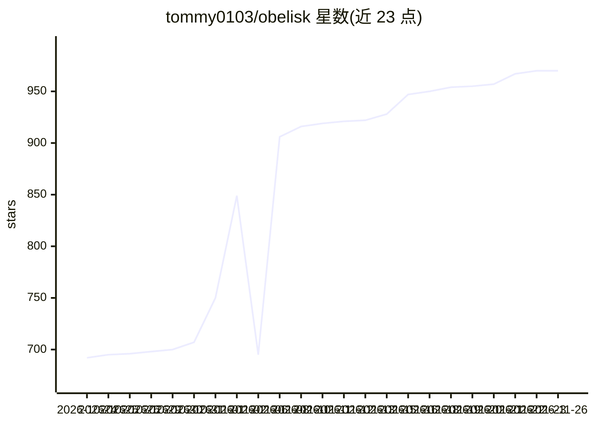

# tommy0103/obelisk

⭐ 970 · JavaScript · AGPL-3.0 · 推送 2026-11-25 · [GitHub](https://github.com/tommy0103/obelisk) · [官网](https://obelisk.antinomie.org) · 个人维护 · 中文 README

**给 coding agent 与开发者检索历史会话的本地索引工具**

Obelisk 将本机多个 coding agent 的历史会话索引到一个 SQLite 库，通过文件监控保持更新，服务两类使用者：agent 侧提供 CLI 与技能文件，agent 编写 JS 查询本地执行并以自然语言回答；人类侧提供 Electron 桌面应用，可浏览会话、管理记忆文件、查看用量统计与周度回顾卡片。索引层覆盖 sessions、messages、tool calls、subagents、workflows 等，支持 FTS5 全文检索。要求 Node.js 22.13+，桌面应用预编译包覆盖 macOS 与 Linux amd64。

## 筛选速览

| 维度 | 判定 | 备注 |
|---|---|---|
| AI 角色 | `ai-ecosystem` | LLM/agent 周边工具 |
| 许可风险 | `viral` | AGPL-3.0 |
| 部署形态 | `library` | 以包/库形式分发 |
| 模型依赖 | — | README 未给出锁定关系 |
| 硬件要求 | — | 无带数字的原话,不猜 |
| 安装摩擦 | `low` | 无编译、无系统依赖或容器化 |
| 成熟度 | — | 结构信号不足 |

## 能力要点

- 将 20K 行 JSONL 会话索引进单个 SQLite 库，支持 search() 与 sql() 查询
- 覆盖 12 个 agent 会话来源，统一投影到共享 schema
- 记忆层：agent 提出结论、用户批准后注册为 markdown 记忆文件并在未来会话召回
- 可选 recap 流程把一段时间的会话生成可分享的周/月回顾卡片

## 适用场景

- 让 coding agent 检索自己过往会话历史来回答问题
- 浏览和检索本机所有 agent 会话、tool call 与 diff
- 查看 agent 使用统计、热力图与每周回顾

## 场景标签

`Agent 记忆` · 领域:Agent 开发

## 证据(README 行号)

> L11: Obelisk indexes your local coding-agent history into one SQLite database and
> L12: serves it to two audiences:
> L14: - **Agents** — the `obelisk` CLI plus an agent skill that teaches coding agents

## 星数曲线

2026-10-24 692 → 2026-11-26 970（+278）

---
*卡片 v1 · prompt 1.4 · 生成 2026-11-26 · 置信度 high · 依据 README sha `d90fa7f96220` · [字段定义](../../DATASET.md)*
