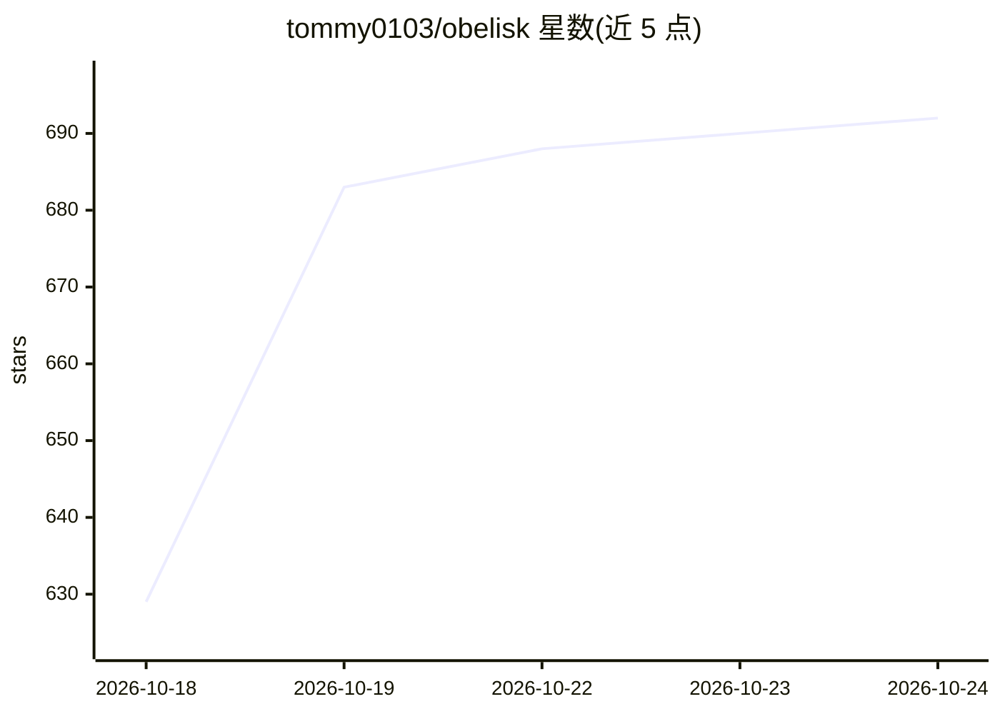

# tommy0103/obelisk

⭐ 695 · JavaScript · AGPL-3.0 · 推送 2026-10-21 · [GitHub](https://github.com/tommy0103/obelisk) · [官网](https://obelisk.antinomie.org) · 个人维护 · 中文 README

**把本地编码代理会话历史索引为 SQLite，供代理查询、供人浏览**

将 Claude Code、Codex、GitHub Copilot、DeepSeek Harness、Hermes Agent、Kiro、Kimi Code、OMP、OpenCode、Pi、ZCode 等编码代理的本地会话历史（JSONL/SQLite）统一索引到单个 SQLite 库，通过 FTS5 全文检索覆盖会话、消息、工具调用、子代理、摘要、工作流等层。两类使用界面：面向代理的 CLI 与技能（代理编写 JS 查询并用自然语言回答），以及面向人的 Electron 桌面应用（浏览会话、管理记忆、使用统计、周报卡片）。附带记忆层与 recap 流程。要求 Node.js 22.13+。

## 筛选速览

| 维度 | 判定 | 备注 |
|---|---|---|
| AI 角色 | `ai-ecosystem` | LLM/agent 周边工具 |
| 许可风险 | `viral` | AGPL-3.0 |
| 部署形态 | `library` | 以包/库形式分发 |
| 模型依赖 | locked-api |  |
| 硬件要求 | — | 无带数字的原话,不猜 |
| 安装摩擦 | `low` | 无编译、无系统依赖或容器化 |
| 成熟度 | — | 结构信号不足 |

## 能力要点

- 11 种编码代理会话源统一索引到单个 SQLite 库，FTS5 全文检索
- 代理可经 /obelisk 技能编写 JS 查询（search()/sql() 等）检索自身历史
- Electron 桌面应用浏览会话、GitHub 风格热图、token 图表与周报卡片
- 记忆层：检索结论经批准注册为 markdown 记忆文件供后续会话召回

## 适用场景

- 让编码代理检索自己过往会话回答'上次这个 bug 怎么修的'
- 在桌面应用中浏览与检索多个编码代理的完整历史
- 按周/月生成可分享的编码活动回顾卡片

## 场景标签

`Agent 记忆` · 领域:Agent 开发

## 证据(README 行号)

> L11: Obelisk indexes your local coding-agent history into one SQLite database and
> L14: - **Agents** — the `obelisk` CLI plus an agent skill that teaches coding agents
> L17: - **Humans** — an Electron desktop app to browse sessions, manage memories,

## 星数曲线

2026-10-18 629 → 2026-10-24 692（+63）

---
*卡片 v1 · prompt 1.4 · 生成 2026-10-21 · 置信度 high · 依据 README sha `207a4a18beaf` · [字段定义](../../DATASET.md)*
