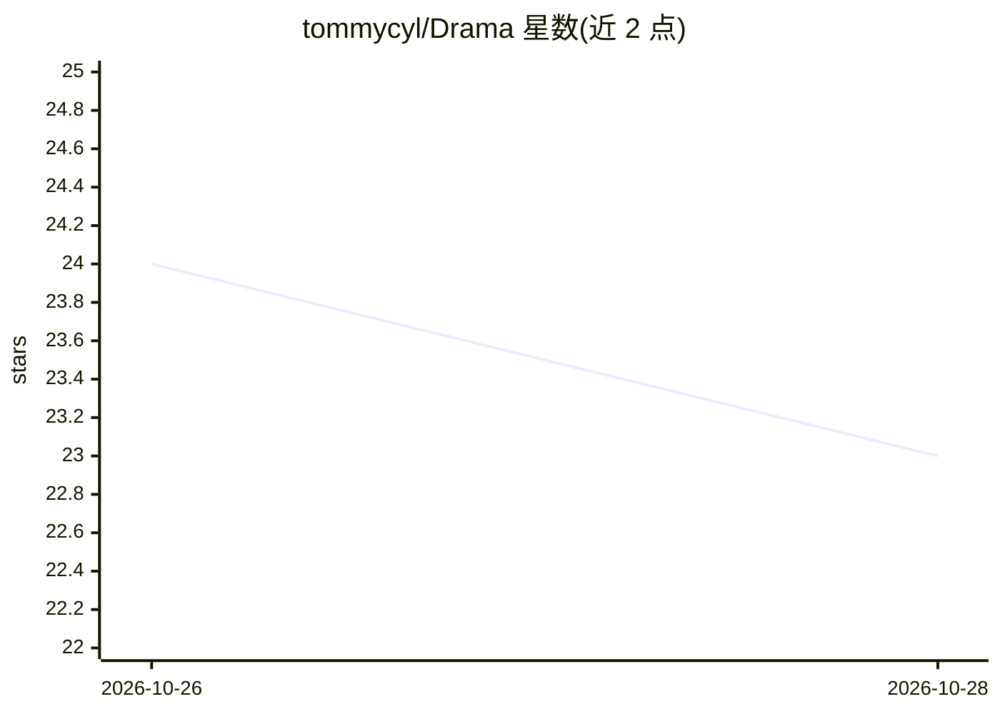

# tommycyl/Drama

⭐ 25 · TypeScript · MIT · 推送 2026-10-28 · [GitHub](https://github.com/tommycyl/Drama) · 个人维护 · 中文 README

**AI 拍摄指导相机 App：用视觉模型给出构图引导**

基于 Expo + React Native 的 Android 优先 AI 摄影指导应用。用户选择拍摄模式（人像/风景/夜景）与美学风格后，将当前取景帧发送给视觉模型，模型返回结构化拍摄方案，设备端显示虚线轨迹与目标圈引导对位，并在本地调节白平衡、对比度、数码变焦等参数，对位稳定后提示可拍摄。自带模型服务（BYO API Key），预置 Kimi 与 DeepSeek，支持任意 Chat Completions 兼容的视觉端点，无独立后端。灵感、相册、个人页已集成，部分卡片与设置仍为演示样式。

## 筛选速览

| 维度 | 判定 | 备注 |
|---|---|---|
| AI 角色 | `ai-native` | 本体是模型或模型工具 |
| 许可风险 | `permissive` | MIT |
| 部署形态 | `library` | 以包/库形式分发 |
| 模型依赖 | locked-api |  |
| 硬件要求 | — | 无带数字的原话,不猜 |
| 安装摩擦 | `low` | 无编译、无系统依赖或容器化 |
| 成熟度 | `idea` | |

## 能力要点

- 单次请求获取构图方案，轨迹对位与就绪判定在本地完成，无连续轮询
- 3 种拍摄模式与 4 种参与 AI 构图推理的美学风格
- BYO 模型服务：应用内填写 API Key/Base URL/模型 ID，支持 Chat Completions 兼容视觉端点
- 自定义 Android 原生模块按设备能力调节白平衡预设与对比度

## 适用场景

- 不会摆机位、不懂参数的用户按轨迹提示拍出构图照片
- 给人像/风景/夜景场景选择模式并获得参数调节
- 用自己的视觉模型 API Key 在手机上获得拍摄指导

## 场景标签

`图像视频处理` · 领域:感知与多模态

## 证据(README 行号)

> L19: Drama is an AI photography guidance app built with **Expo + React Native**, targeting Android first. Select your sh
> L21: **One request, one-step guidance, completed locally.** No continuous video streaming, no periodic polling of the mo

## 星数曲线

2026-10-26 24 → 2026-10-28 23（-1）

---
*卡片 v1 · prompt 1.4 · 生成 2026-10-27 · 置信度 high · 依据 README sha `222ca83ed22e` · [字段定义](../../DATASET.md)*
