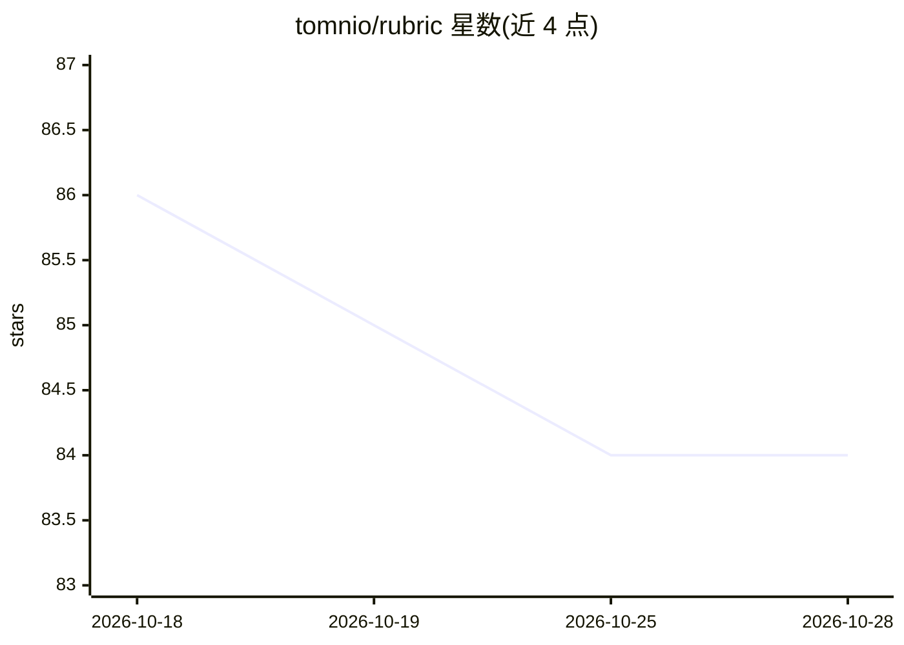

# tomnio/rubric

⭐ 84 · TypeScript · MIT · 推送 2026-09-28 · [GitHub](https://github.com/tomnio/rubric) · 个人维护

**给 TypeScript 开发者：从 LLM 单次调用或长文档提取经 Zod 校验的 JSON**

Schema-first 的结构化提取库：开发者定义 Zod schema，Rubric 将 schema 附到请求上，从回复中抽取 JSON、校验，失败时携带错误重新请求直到通过或重试耗尽，返回类型化结果或类型化错误。针对超出上下文窗口的长文档，createDocument() 分块提取并合并（重叠去重、实体键合并、冲突检测、中断返回部分结果），基准测试中在 56 与 151 页文档上测得 100% 召回 / 0% 重复。支持 OpenAI、Anthropic、Gemini 及 OpenAI 兼容网关（DeepSeek/Groq/OpenRouter/Together/Moonshot）；另提供 PDF 文本层提取（无 OCR）。不包含 CLI、批处理或缓存。需 Node 20+ 与 pnpm，zod 为必选依赖。

## 筛选速览

| 维度 | 判定 | 备注 |
|---|---|---|
| AI 角色 | `ai-ecosystem` | LLM/agent 周边工具 |
| 许可风险 | `permissive` | MIT |
| 部署形态 | `library` | 以包/库形式分发 |
| 模型依赖 | locked-api |  |
| 硬件要求 | — | 无带数字的原话,不猜 |
| 安装摩擦 | `low` | 无编译、无系统依赖或容器化 |
| 成熟度 | — | 结构信号不足 |

## 能力要点

- create() 返回 z.infer<S> 或类型化错误，失败自动带错误 reask（默认 maxRetries 3）
- createDocument() 长文档分块提取合并：重叠感知去重、dedupeBy 实体键合并、onConflict 冲突检测、中断返回部分结果与逐块出处
- 基准测试宣称 100% 召回 / 0% 重复（56 与 151 页）
- tokenBudget / timeout / OutputTruncatedError 等预算与截断保证；支持流式 createPartial/createIterable 与引用校验 cited()

## 适用场景

- 从合同、财报等超长文档中提取结构化字段而不丢失跨块实体
- 需要 LLM 输出严格符合 Zod schema 的 TypeScript 应用
- 对提取结果要求可溯源（逐块出处、引用校验）的数据管线

## 场景标签

`文档解析` · 领域:知识与检索

## 证据(README 行号)

> L9: Schema-first structured extraction from LLMs. You define a Zod schema. Rubric puts that schema on the request, pulls
> L26: 1. **One call can't be trusted.** Models miss schema fields, drift on formats, invent values. Rubric closes this lo

## 星数曲线

2026-10-18 86 → 2026-10-28 84（-2）

---
*卡片 v1 · prompt 1.4 · 生成 2026-10-24 · 置信度 high · 依据 README sha `1bb5cf063563` · [字段定义](../../DATASET.md)*
