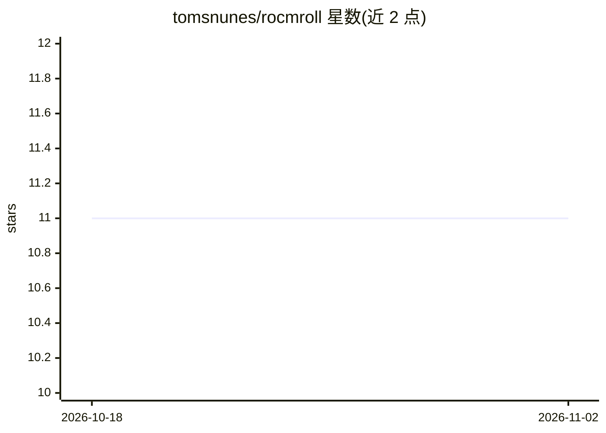

# tomsnunes/rocmroll

⭐ 11 · PowerShell · MIT · 推送 2026-10-20 · [GitHub](https://github.com/tomsnunes/rocmroll) · 个人维护

**Windows 上管理便携 ComfyUI+ROCm 实例的 PowerShell 平台管理器**

面向 AMD Radeon GPU 用户的 Windows 原生 PowerShell 工具，用于创建、启动、更新、诊断与修复可复现的 ComfyUI 便携实例。它管理 Python 3.12 运行时、每实例环境、ROCm/PyTorch wheel 安装与校验、custom_nodes、共享资产目录与生成的启动器；编排逻辑置于 ComfyUI 之外。支持命令式 instance 命令与可选的声明式 import/plan/apply/destroy 工作流，按 stable/preview/nightly 等 6 个通道安装，并可按 GPU 家族自动切换通道。仅支持 Windows，不支持 NVIDIA/Intel GPU 与 Linux/WSL/macOS。

## 筛选速览

| 维度 | 判定 | 备注 |
|---|---|---|
| AI 角色 | `ai-ecosystem` | LLM/agent 周边工具 |
| 许可风险 | `permissive` | MIT |
| 部署形态 | `desktop` | 安装包/桌面程序 |
| 模型依赖 | — | README 未给出锁定关系 |
| 硬件要求 | — | 无带数字的原话,不猜 |
| 安装摩擦 | `low` | 无编译、无系统依赖或容器化 |
| 成熟度 | — | 结构信号不足 |

## 能力要点

- 每实例独立 Python 环境与 ComfyUI checkout，共享模型等重型资产
- 6 个安装通道（stable/preview/nightly/next/legacy/legacy-staging）并按 GPU 家族自动切换
- 声明式 YAML 实例定义与 import/plan/apply/destroy 收敛式工作流
- AMD GPU 检测（精确到芯片型号）与手动 --gfx 覆盖、ROCm/PyTorch 校验脚本

## 适用场景

- 在 Windows AMD 显卡上快速搭建可复现的 ComfyUI 环境
- 维护多个隔离的 ComfyUI 实例并按需更新/修复/销毁
- RDNA1/2 等无官方 stable wheel 的 GPU 自动回退到可用通道

## 场景标签

`图像生成` · 领域:内容生成

## 证据(README 行号)

> L5:  ROCmRoll is a Windows-native platform manager for portable ComfyUI environments optimized for AMD Radeon GPUs using
> L30: - Thin `rocmroll.bat` wrapper around `source\rocmroll.ps1`
> L42: - ROCm/PyTorch validation via `source\scripts\validate-rocm.py`

## 星数曲线

2026-10-18 11 → 2026-11-02 11（+0）

---
*卡片 v1 · prompt 1.4 · 生成 2026-11-01 · 置信度 mid · 依据 README sha `a3acf91772d6` · [字段定义](../../DATASET.md)*
