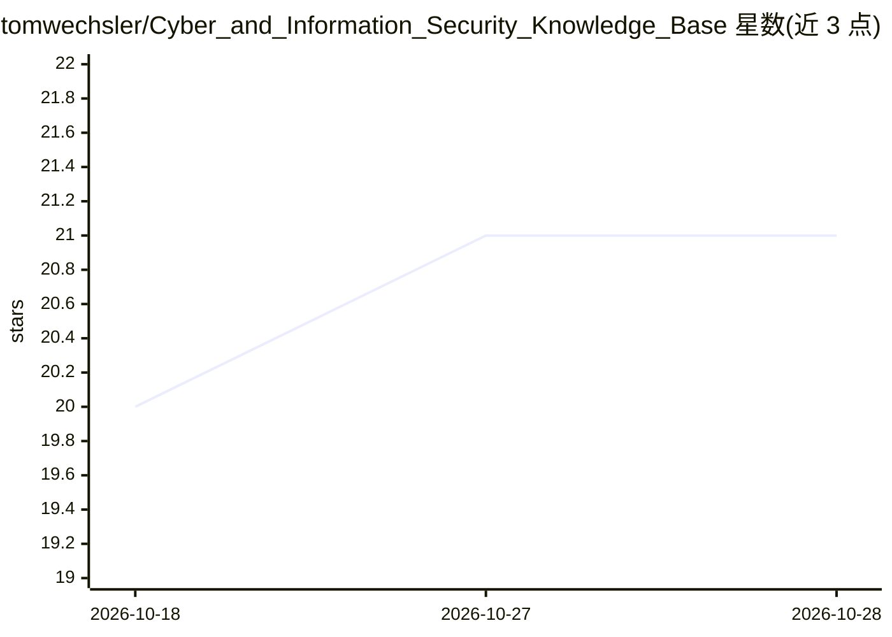

# tomwechsler/Cyber_and_Information_Security_Knowledge_Base

⭐ 21 · Jupyter Notebook · GPL-3.0 · 推送 2026-10-26 · [GitHub](https://github.com/tomwechsler/Cyber_and_Information_Security_Knowledge_Base) · 个人维护

**网络安全标准与框架的结构化知识库：供专业人员查阅参考**

聚合网络安全与信息安全标准、框架、最佳实践和指南的文档型知识库，内容来源覆盖 NIST、ISO/IEC、OWASP、CIS、ISACA、ENISA 等机构。按 frameworks、guidelines、best-practices、mappings 等目录组织，每个文档包含标准摘要、核心组件结构、适用场景、原始资源链接及跨框架映射（如 NIST 与 ISO 27001 对照）。面向安全专业人员、GRC 从业者、审计顾问、开发者和学生，用于支撑安全项目建设、审计与合规工作。以 Markdown 文档仓库形式提供，GPL-3.0 许可。

## 筛选速览

| 维度 | 判定 | 备注 |
|---|---|---|
| AI 角色 | `ai-knowledge` | 知识聚合/清单类 |
| 许可风险 | `viral` | GPL-3.0 |
| 部署形态 | `None` |  |
| 模型依赖 | — | README 未给出锁定关系 |
| 硬件要求 | — | 无带数字的原话,不猜 |
| 安装摩擦 | `low` | 无编译、无系统依赖或容器化 |
| 成熟度 | — | 结构信号不足 |

## 能力要点

- 覆盖 NIST、ISO/IEC、OWASP、CIS、ISACA、ENISA 等机构的标准与框架
- 按 frameworks/guidelines/best-practices/mappings 目录结构化组织
- 提供跨框架映射与对照文档（如 NIST-to-ISO27001、OWASP-vs-CIS）
- 每个文档含摘要、核心组件、适用场景与原始资源链接

## 适用场景

- 备考或学习安全认证时查阅各标准框架要点
- 合规与审计工作中对照 NIST 与 ISO 27001 要求
- 为安全体系建设选型合适的框架并找到官方资源

## 场景标签

`网络安全` · 领域:学习与行业

## 证据(README 行号)

> L2: A structured knowledge base of cybersecurity and information security standards, frameworks, best practices, and gui
> L28: 📁 frameworks/

## 星数曲线

2026-10-18 20 → 2026-10-28 21（+1）

---
*卡片 v1 · prompt 1.4 · 生成 2026-10-28 · 置信度 high · 依据 README sha `c5e386d0864e` · [字段定义](../../DATASET.md)*
