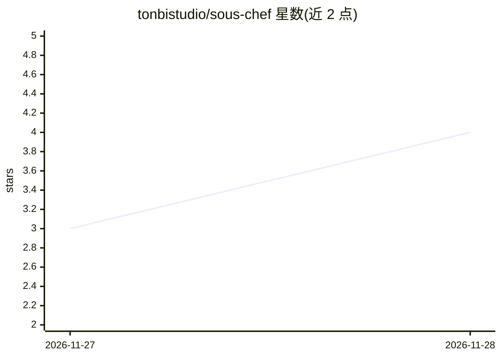

# tonbistudio/sous-chef

⭐ 4 · TypeScript · MIT · 推送 2026-11-25 · [GitHub](https://github.com/tonbistudio/sous-chef) · 个人维护

**面向长屏录像的本地视频编辑器，AI 代理代做粗剪**

基于 Electron 的本地视频编辑器，针对长篇屏幕录像（教程、演示）：AI 代理 Hermes 转录音频、删除口误与超 1.5 秒静音、生成缩放/字幕/HTML 动效，并撰写 YouTube 标题、描述与缩略图选项；每条建议需人工接受或拒绝，另提供手动时间线、画中画、多轨道、配音录制与 ffmpeg 导出。依赖 Node.js 22、ffmpeg、WhisperX 转写脚本与外部 Hermes Agent（编辑器本身不存模型密钥），暂无安装包，需从源码运行；Windows 为主要测试平台。

## 筛选速览

| 维度 | 判定 | 备注 |
|---|---|---|
| AI 角色 | `ai-native` | 本体是模型或模型工具 |
| 许可风险 | `permissive` | MIT |
| 部署形态 | `library` | 以包/库形式分发 |
| 模型依赖 | — | README 未给出锁定关系 |
| 硬件要求 | — | 无带数字的原话,不猜 |
| 安装摩擦 | `medium` | 含编译或系统依赖之一 |
| 成熟度 | `idea` | |

## 能力要点

- 转录编辑：删除文字即剪掉片段，删除项保留可恢复
- Teach Hermes：学习用户最终粗剪模式写入 Hermes 技能
- 通过 MCP（stdio 与 HTTP）向本地或远程 Hermes 暴露 9 个编辑工具
- 一键生成缩略图与 YouTube feed 预览的发布视图

## 适用场景

- 把数小时教学录屏快速剪成可发布视频
- 逐条审核 AI 粗剪建议后手动微调时间线
- 为 YouTube 视频生成标题、描述与缩略图选项
- 让 VPS 上的 Hermes 代理通过隧道远程编辑项目

## 场景标签

 · 领域:视频创作工具

## 证据(README 行号)

> L3: A local video editor where an AI agent does most of the edit. Built for long-form
> L4: screen recordings (tutorials, demos): the agent transcribes, cuts flubbed lines and
> L79:  itself). The manual editor works without it.

## 星数曲线

2026-11-27 3 → 2026-11-28 4（+1）

---
*卡片 v1 · prompt 1.4 · 生成 2026-11-27 · 置信度 mid · 依据 README sha `a7c4a27dfe4a` · [字段定义](../../DATASET.md)*
