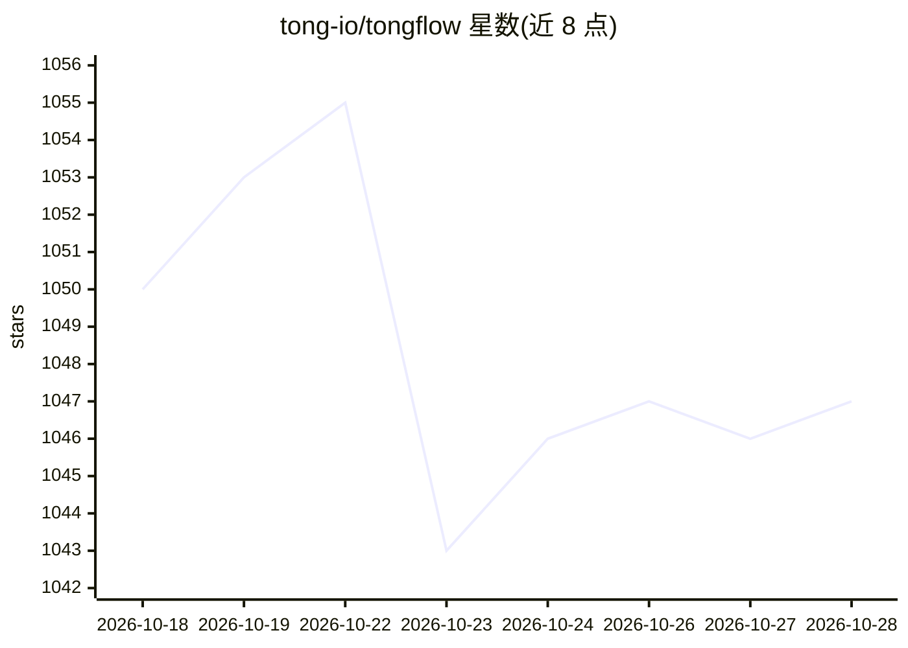

# tong-io/tongflow

⭐ 1,048 · TypeScript · AGPL-3.0 · 推送 2026-10-28 · [GitHub](https://github.com/tong-io/tongflow) · [官网](https://app.tongflow.com/workspace) · 组织维护 · 中文 README

**多模态优先的开源 GenAI 平台：画布式组合文本/图像/音频/视频/3D 工作流**

以模态（文本、图像、音频、视频、3D、文档、URL）为基本单元的生成式 AI 工作流平台：用户在画布上以添加、转换、组合、拆分四类操作串联节点，每步可更换背后执行的插件与模型，任何输出都可成为下一步素材。官方插件覆盖 Gemini、OpenAI、DeepSeek、字节豆包、xAI、Qwen 等直连 API 与 OpenRouter 聚合路由，GPU/CPU 插件经 Modal 运行（每月提供最高 30 美元免费额度）。提供桌面安装包（macOS/Windows，桌面端为约 10MB 的云工作室外壳）、自托管（源码或 Docker）及 npm 包/Agent（Claude Code、MCP、dsh）三种使用方式。

## 筛选速览

| 维度 | 判定 | 备注 |
|---|---|---|
| AI 角色 | `ai-native` | 本体是模型或模型工具 |
| 许可风险 | `dual` | AGPL-3.0 |
| 部署形态 | `desktop` | 安装包/桌面程序 |
| 模型依赖 | locked-api |  |
| 硬件要求 | — | 无带数字的原话,不猜 |
| 安装摩擦 | `low` | 无编译、无系统依赖或容器化 |
| 成熟度 | — | 结构信号不足 |

## 能力要点

- 画布式多模态工作流，节点可替换插件与模型并保留结构
- 官方插件覆盖图像/视频/音频/3D 生成、理解、编辑等能力矩阵
- API 直连（Gemini/OpenAI/DeepSeek/字节/xAI/Qwen 等）与 OpenRouter 路由插件
- 桌面安装包、Docker 自托管与 npm 包/Agent 三种使用途径

## 适用场景

- 在画布上组合文生图、语音合成、数字人对口型视频等多模态流程
- 通过 Claude Code / MCP 客户端让 Agent 构建可复用的工作流
- 自托管并按节点选择不同厂商模型运行生成任务

## 场景标签

`工作流自动化` `图像生成` `语音合成` `多模态` · 领域:效率与自动化

## 证据(README 行号)

> L16: **Different modalities. One workflow.**
> L18: Text, images, audio, video and 3D are your materials. Decide how they transform and combine, then choose the model 
> L36: There are three ways to use TongFlow, all sharing the same open-source core: **TongFlow Cloud** (the desktop app or

## 星数曲线

2026-10-18 1,050 → 2026-10-28 1,047（-3）

---
*卡片 v1 · prompt 1.4 · 生成 2026-10-21 · 置信度 high · 依据 README sha `235927af2c2d` · [字段定义](../../DATASET.md)*
