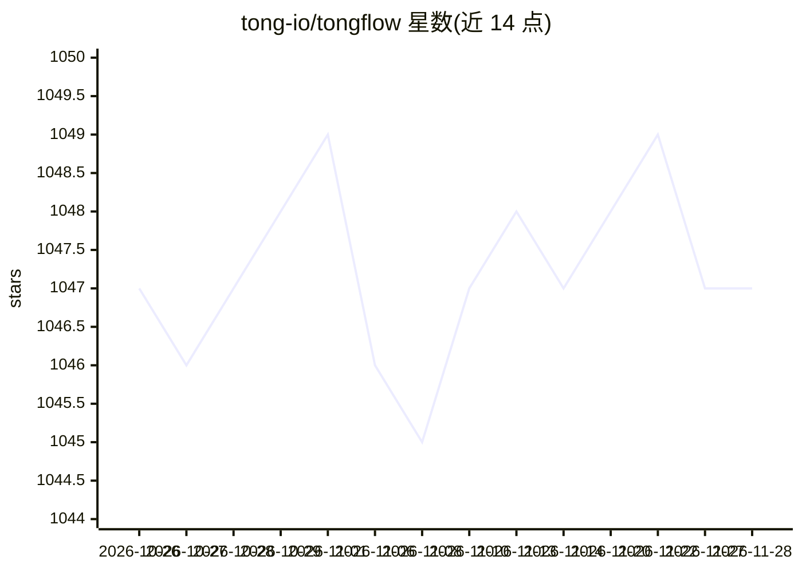

# tong-io/tongflow

⭐ 1,047 · TypeScript · AGPL-3.0 · 推送 2026-11-22 · [GitHub](https://github.com/tong-io/tongflow) · [官网](https://www.tongflow.com) · 组织维护 · 中文 README

**企业级 GenAI 工作流平台：让非程序员与 agent 共建可追溯的多模态工作流**

TongFlow 是一个 GenAI 工作流平台，围绕画布组织七种模态（文本、图像、音频、视频、3D、文档、链接）的素材加工。能力与模型解耦，通过 60 余项能力与 50 余个官方插件接入商业 API、模型网关与开源模型。AI agent 与人使用同一套工具构建工作流，产物为可编辑复跑的工作流文件，每次运行留下记录，付费运行需人工审批。提供自托管（源码或 Docker）、私有部署与在线试用三种运行方式，采用 AGPL-3.0 与商业许可双许可。

## 筛选速览

| 维度 | 判定 | 备注 |
|---|---|---|
| AI 角色 | `ai-native` | 本体是模型或模型工具 |
| 许可风险 | `dual` | AGPL-3.0 |
| 部署形态 | `library` | 以包/库形式分发 |
| 模型依赖 | — | README 未给出锁定关系 |
| 硬件要求 | — | 无带数字的原话,不猜 |
| 安装摩擦 | `low` | 无编译、无系统依赖或容器化 |
| 成熟度 | — | 结构信号不足 |

## 能力要点

- agent 与人共用同一工具集构建工作流，产物为可编辑的工作流文件
- 七种模态在同一画布上流转，每步输出留在画布上
- 60+ 能力与 50+ 官方插件，能力与模型解耦可替换
- 运行历史记录工作流、步骤、插件、模型、输入输出与耗时

## 适用场景

- 把产品照片和要点生成文案、图片、配音与短视频
- 将文档、音视频本地化到其他语言
- 把会议录音和文档转成纪要与摘要
- 将成品工作流封装为表单给更多人使用

## 场景标签

`工作流自动化` `AI 写作` `多模态` · 领域:效率与自动化

## 证据(README 行号)

> L3:  TongFlow — Agent-Human-Friendly, Modality-First, Enterprise-Level GenAI Workflow Platform
> L56: - Seven modalities — text, images, audio, video, 3D, documents and links — flow on one canvas.
> L57: - Capabilities are separate from models, so the implementation behind a step can change.

## 星数曲线

2026-10-26 1,047 → 2026-11-28 1,047（+0）

---
*卡片 v1 · prompt 1.4 · 生成 2026-11-24 · 置信度 mid · 依据 README sha `ec3f8f1f4974` · [字段定义](../../DATASET.md)*
