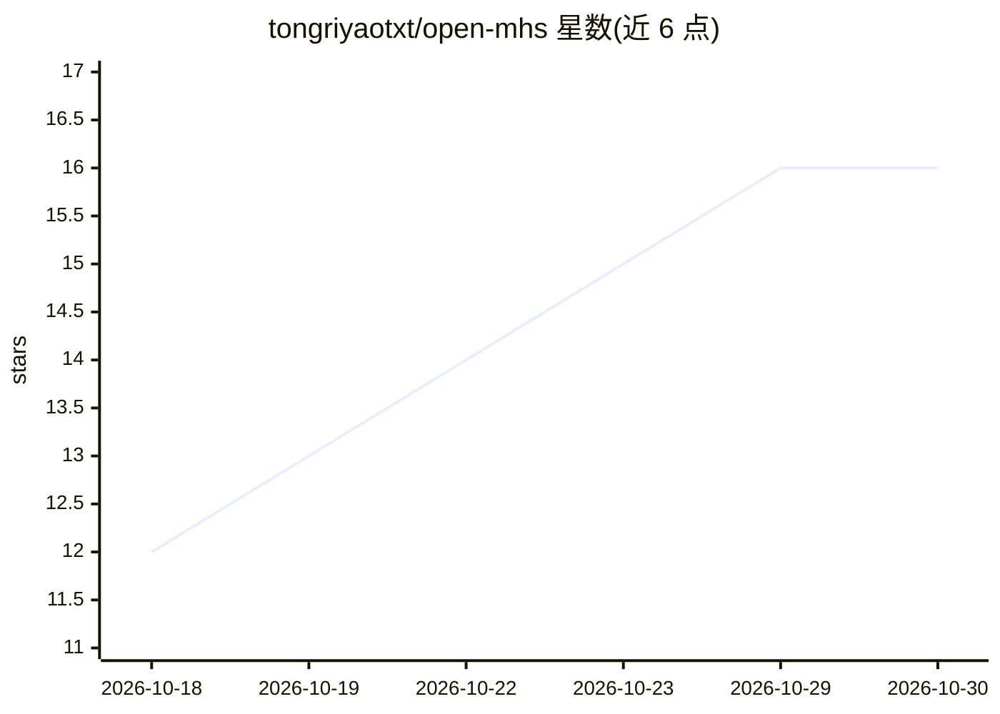

# tongriyaotxt/open-mhs

⭐ 16 · Python · MIT · 推送 2026-09-06 · [GitHub](https://github.com/tongriyaotxt/open-mhs) · 个人维护

**AI agent 硬件控制的开源标准实现：统一协议操控物理设备**

受 Anthropic Model Hardware Standard 启发的开源实现，让 AI agent 通过统一协议发现、监控和安全操控物理设备，自述为‘物理世界的 MCP’。支持传感器、摄像头、树莓派 GPIO、Arduino、智能家居、机械臂、实验室设备等多类硬件，提供 CLI、REST API 与 MCP server 三种接入方式。核心的 Cerebellum 层负责闭环运动技能、前向模型与反射弧（约 50ms 内中止动作，无需等待 LLM）。项目自声明为基于公开信息的 early alpha。

## 筛选速览

| 维度 | 判定 | 备注 |
|---|---|---|
| AI 角色 | `ai-ecosystem` | LLM/agent 周边工具 |
| 许可风险 | `permissive` | MIT |
| 部署形态 | `library` | 以包/库形式分发 |
| 模型依赖 | — | README 未给出锁定关系 |
| 硬件要求 | — | 无带数字的原话,不猜 |
| 安装摩擦 | `low` | 无编译、无系统依赖或容器化 |
| 成熟度 | `idea` | |

## 能力要点

- 统一设备接口 + MCP 兼容（设备暴露为 MCP 工具）
- Cerebellum 层：闭环运动技能、前向模型、单 tick 反射中止
- 支持从传感器到机械臂、3D 打印机、双足机器人的多类硬件
- CLI / REST API / MCP server 多传输方式

## 适用场景

- 让 Claude、Kimi、GPT 等 agent 通过 MCP 操控实验室设备或机器人
- 为机器人项目提供带安全反射机制的运动技能层
- 通过演示教学让 cerebellum 学习并泛化新的运动技能

## 场景标签

`Agent 框架` `GUI 自动化` · 领域:Agent 开发

## 证据(README 行号)

> L10: MHS enables AI agents to **discover, monitor, and safely operate physical devices** through a unified protocol. Thi
> L22: - **MCP Compatible** — Expose devices as MCP tools
> L23: - **Multi-Transport** — CLI, REST API, and MCP server

## 星数曲线

2026-10-18 12 → 2026-10-30 16（+4）

---
*卡片 v1 · prompt 1.4 · 生成 2026-10-30 · 置信度 high · 依据 README sha `278648c7a48d` · [字段定义](../../DATASET.md)*
