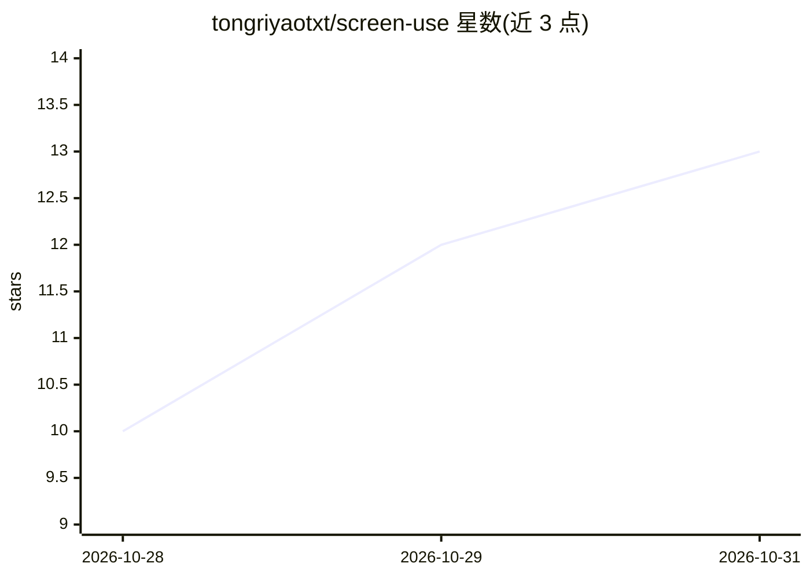

# tongriyaotxt/screen-use

⭐ 13 · Python · MIT · 推送 2026-10-28 · [GitHub](https://github.com/tongriyaotxt/screen-use) · 个人维护 · 中文 README

**让 AI Agent 通过视觉操作整个 Windows 桌面的 MCP 工具层**

面向 Windows 桌面的 agent 感知与操作层：通过 18 个 MCP 工具或 Python SDK，让 Claude、Kimi CLI、Cursor 等 agent 截图、读取 UIA 无障碍树、像素级点击与输入，从而操作任意桌面应用。定位采用 UIA 文本匹配优先的策略链，多数动作无需模型调用；VLM 为可选，支持 Ollama 本地或云端模型处理 UIA 不可见界面。提供 observe→think→act→verify 自主循环、卡住原因分类反思与元学习记忆，含 dry_run、confirm_callback 与鼠标急停等安全机制。仅支持 Windows 平台。

## 筛选速览

| 维度 | 判定 | 备注 |
|---|---|---|
| AI 角色 | `ai-ecosystem` | LLM/agent 周边工具 |
| 许可风险 | `permissive` | MIT |
| 部署形态 | `desktop` | 安装包/桌面程序 |
| 模型依赖 | local-ok | 支持本地模型 |
| 硬件要求 | — | 无带数字的原话,不猜 |
| 安装摩擦 | `low` | 无编译、无系统依赖或容器化 |
| 成熟度 | — | 结构信号不足 |

## 能力要点

- 18 个 MCP 工具 + Python SDK，接入任意 MCP 兼容 agent
- UIA 无障碍树优先定位，多数动作零模型调用，VLM 可选
- 自主任务循环：卡住分类反思 + 元学习记忆（~/.screen_use/）
- dry_run 模拟、逐动作确认回调、鼠标甩角急停等安全机制

## 适用场景

- 让 Claude/Kimi/Cursor 等 agent 跨应用操作桌面软件（如计算器→记事本）
- 自动化无 API 的遗留系统（SAP GUI、ERP、行业终端）
- 需要本地运行、屏幕数据不出机的隐私敏感自动化

## 场景标签

`GUI 自动化` · 领域:效率与自动化

## 证据(README 行号)

> L45:         │  MCP or Python SDK
> L57: - 🔌 **Plugs in** — 18 MCP tools instantly available to any MCP host (Kimi CLI, Claude Desktop, Cursor), or a 3-line
> L50: **VLM is optional, not required.** The locating strategy chain hits most targets with pure Accessibility-tree text 

## 星数曲线

2026-10-28 10 → 2026-10-31 13（+3）

---
*卡片 v1 · prompt 1.4 · 生成 2026-10-31 · 置信度 mid · 依据 README sha `99358e37e791` · [字段定义](../../DATASET.md)*
