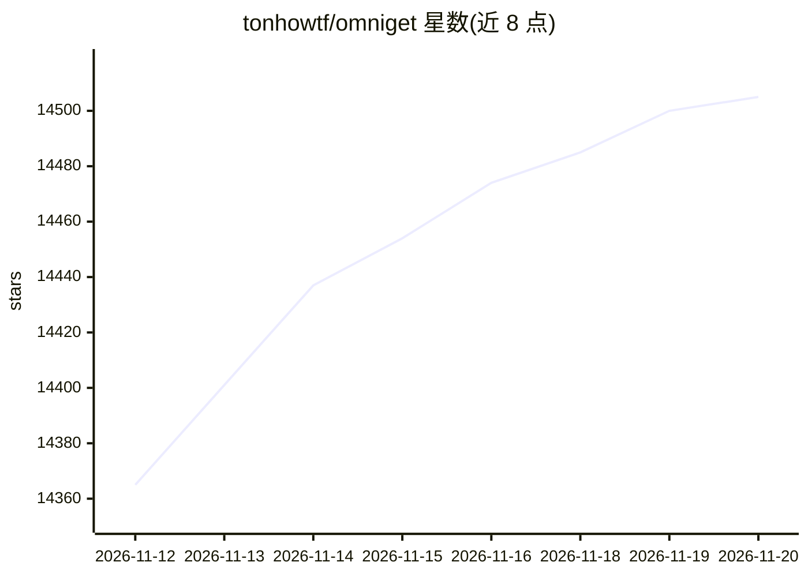

# tonhowtf/omniget

⭐ 14,505 · Rust · GPL-3.0 · 推送 2026-11-19 · [GitHub](https://github.com/tonhowtf/omniget) · [官网](https://getomniget.com/) · 个人维护

**本地 MCP 服务器：给编码代理提供下载、媒体与系统工具箱**

基于 Tauri/Svelte 的桌面应用，内置本地 MCP 服务器（HTTP 监听 127.0.0.1:47720），为 Claude Code、Codex、Cursor、Gemini CLI 等编码代理提供下载（YouTube/种子/yt-dlp 支持的站点）、媒体转换、文件处理、聊天读取与系统清理等工具。敏感操作需用户在应用窗口点击批准，每连接独立 token 与权限。提供 Windows/macOS/Linux 安装包及 omniget-cli、omniget-mcp 命令行工具。yt-dlp、FFmpeg 等依赖随应用自动安装更新。

## 筛选速览

| 维度 | 判定 | 备注 |
|---|---|---|
| AI 角色 | `ai-ecosystem` | LLM/agent 周边工具 |
| 许可风险 | `viral` | GPL-3.0 |
| 部署形态 | `desktop` | 安装包/桌面程序 |
| 模型依赖 | locked-api |  |
| 硬件要求 | — | 无带数字的原话,不猜 |
| 安装摩擦 | `medium` | 含编译或系统依赖之一 |
| 成熟度 | — | 结构信号不足 |

## 能力要点

- 一行命令连接 Claude Code/Codex/Cursor/Gemini CLI 等代理
- 下载覆盖 YouTube、种子、Telegram 及 yt-dlp/gallery-dl 支持的站点
- 敏感操作需用户点击批准，本地监听且不向代理返回密钥
- 提供 Windows/macOS/Linux 安装包与 CLI、stdio 桥接工具

## 适用场景

- 让编码代理批量下载链接并汇报失败原因
- 把文件夹转成可直接粘贴进提示词的单文件
- 通过代理查询并管理系统端口、清理垃圾文件
- 多个代理在 Canvas 面板中并行运行与协作

## 场景标签

 · 领域:桌面工具/AI 代理基础设施

## 证据(README 行号)

> L10:  An MCP server that gives your coding agent a whole desktop toolbox.
> L33: **2.** Paste this line into Claude Code, Codex, Gemini CLI, Cursor or any agent that can run a command:
> L73: The server speaks MCP over HTTP at `http://127.0.0.1:47720/mcp`. Create a connection in **Settings → AI & agents → 

## 星数曲线

2026-11-12 14,365 → 2026-11-20 14,505（+140）

---
*卡片 v1 · prompt 1.4 · 生成 2026-11-17 · 置信度 mid · 依据 README sha `014ab4666231` · [字段定义](../../DATASET.md)*
